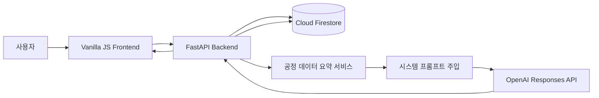
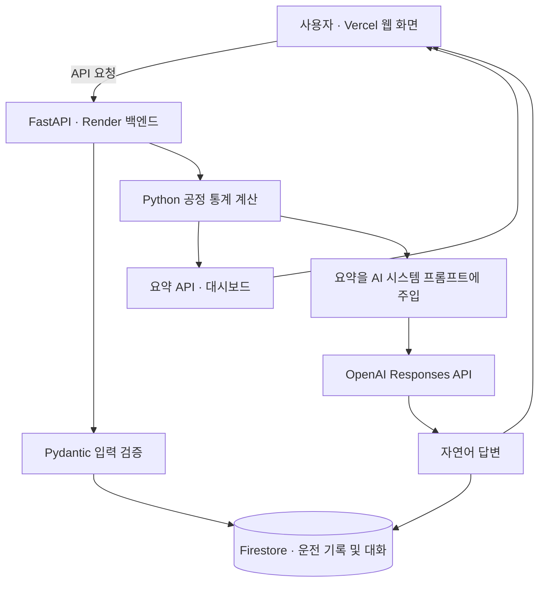

# DistillMate

증류탑 에너지·품질 운전 데이터를 분석하고, 사용자의 공정 데이터를 바탕으로 맞춤형 답변을 제공하는 AI 공정 분석 비서입니다.

## 1. 서비스 소개

일반적인 AI 챗봇은 사용자의 실제 공정 데이터를 알지 못하기 때문에 구체적인 운전 상태를 설명하기 어렵습니다.

DistillMate는 Firestore에 저장된 증류탑 시계열 데이터를 분석해 요약 정보를 생성하고, 이 요약을 OpenAI 시스템 프롬프트에 주입합니다.

사용자는 자연어 질문을 통해 다음 내용을 확인할 수 있습니다.

- 최근 스팀 원단위 변화
- 증류탑 에너지 효율 추세
- 제품 순도 기준 미달
- 이상 운전 발생 시점
- 정비 전후 에너지 효율 변화

> 본 프로젝트의 데이터는 포트폴리오 및 교육 목적으로 생성한 합성 데이터입니다. 실제 설비 운전값 변경에는 현장 엔지니어의 검토가 필요합니다.

## 2. 주요 기능

### 데이터 기반 AI 채팅

- 저장된 공정 데이터 요약을 시스템 프롬프트에 주입
- 증류탑 에너지 효율과 품질에 대한 맞춤형 답변
- AI 응답 대기 중 로딩 표시
- 기존 대화의 문맥을 활용한 후속 질문

### 운전 데이터 관리

- 운전 데이터 추가·조회·수정·삭제
- 스팀 원단위 자동 계산

### 공정 데이터 분석

- 데이터 기간 및 개수
- 평균·최대·최소 스팀 원단위
- 평균 제품 순도와 기준 미달 횟수
- 최근 7일과 이전 7일 비교
- 이상 운전 날짜
- 정비 전후 스팀 원단위 변화

### 대화 기록

- AI 채팅 자동 저장
- 대화 목록 조회 및 특정 대화 불러오기
- 대화 삭제

### 추가 기능

- 스팀 원단위 추세 그래프
- CSV 데이터 내보내기
- 다크 모드
- 반응형 화면

## 3. 데이터 설명

총 180일의 증류탑 운전 시계열 데이터를 사용합니다.

- 기간: 2026-01-01 ~ 2026-06-29
- 데이터 개수: 180개
- 핵심 지표: 스팀 원단위
- 계산식: `스팀 원단위 = 스팀 유량 / 유출액 유량`

현재 데이터 분석 결과:

- 평균 스팀 원단위: 1.282 kg-steam/kg-product
- 평균 제품 순도: 96.12%
- 제품 순도 기준 미달: 18회
- 최근 원단위 변화율: +7.42%
- 최근 에너지 효율 상태: 악화
- 정비 전후 원단위 변화율: -14.98%

## 4. 기술 스택

### Backend

- Python 3.12
- FastAPI, Uvicorn, Pydantic
- Firebase Admin SDK, Cloud Firestore
- OpenAI Responses API

### Frontend

- HTML, CSS, Vanilla JavaScript
- Canvas API

### Deployment

- Backend: Render
- Frontend: Vercel
- Database: Firebase Firestore

## 5. 시스템 구조



## 6. AI 컨텍스트 주입 흐름

1. 사용자가 공정 관련 질문을 입력합니다.
2. FastAPI가 Firestore의 운전 데이터를 조회합니다.
3. 평균, 최대, 최소, 최근 추세와 이상 운전을 계산합니다.
4. 계산된 데이터 요약을 시스템 프롬프트에 삽입합니다.
5. 사용자 질문과 기존 대화 내용을 OpenAI API에 전달합니다.
6. AI 답변을 사용자에게 반환합니다.
7. 질문과 답변을 Firestore의 `conversations` 컬렉션에 저장합니다.

이 방식을 통해 AI가 일반적인 답변이 아니라 실제 저장 데이터에 근거한 답변을 생성합니다.

## 7. Firestore 구조

### data 컬렉션

```text
data/{document_id}
├─ date
├─ value
├─ memo
├─ feed_flow_kg_h
├─ steam_flow_kg_h
├─ distillate_flow_kg_h
├─ reflux_ratio
├─ product_purity_pct
├─ top_temperature_c
├─ bottom_temperature_c
└─ operating_status
```

### conversations 컬렉션

```text
conversations/{conversation_id}
├─ title
├─ messages
│  ├─ role
│  ├─ content
│  └─ timestamp
├─ created_at
└─ updated_at
```

## 8. API 목록

| Method | Endpoint | 설명 |
|---|---|---|
| GET | `/health` | 서버 상태 확인 |
| POST | `/api/data` | 데이터 추가 |
| GET | `/api/data` | 데이터 목록 조회 |
| PUT | `/api/data/{id}` | 데이터 수정 |
| DELETE | `/api/data/{id}` | 데이터 삭제 |
| GET | `/api/data/summary` | 공정 데이터 요약 |
| POST | `/api/chat` | 데이터 기반 AI 채팅 |
| POST | `/api/conversations` | 대화 저장 |
| GET | `/api/conversations` | 대화 목록 조회 |
| GET | `/api/conversations/{id}` | 특정 대화 불러오기 |
| DELETE | `/api/conversations/{id}` | 대화 삭제 |

## 9. 배포 URL

- 프론트엔드: https://backend-seven-ivory-84.vercel.app
- 백엔드 API: https://distillmate-api.onrender.com
- Swagger UI: https://distillmate-api.onrender.com/docs

## 10. 로컬 실행 방법

### 저장소 내려받기

```powershell
git clone https://github.com/zzangminju/distillmate.git
cd distillmate
```

### 가상환경 생성 및 실행

```powershell
python -m venv .venv
.\.venv\Scripts\Activate.ps1
```

### 패키지 설치

```powershell
python -m pip install -r .\backend\requirements.txt
```

### 환경변수 설정

프로젝트 최상위의 `.env.example`을 복사해 `.env`를 생성합니다.

```powershell
Copy-Item .env.example .env
```

로컬 Firebase 서비스 계정 키 파일을 프로젝트 최상위에 `firebase-service-account.json`이라는 이름으로 저장합니다.

### 백엔드 실행

```powershell
python -m uvicorn backend.app.main:app --reload --port 8000
```

- API: http://127.0.0.1:8000
- Swagger: http://127.0.0.1:8000/docs

### 프론트엔드 실행

새 터미널에서 실행합니다.

```powershell
python -m http.server 5500 --directory frontend
```

- Frontend: http://127.0.0.1:5500

## 11. 환경변수

| 변수 | 사용 환경 | 설명 |
|---|---|---|
| `OPENAI_API_KEY` | Backend | OpenAI API 키 |
| `OPENAI_MODEL` | Backend | 사용할 OpenAI 모델 |
| `FIREBASE_SERVICE_ACCOUNT_PATH` | Local | Firebase 키 파일 경로 |
| `FIREBASE_SERVICE_ACCOUNT_JSON` | Render | Firebase 서비스 계정 JSON 문자열 |
| `ALLOWED_ORIGINS` | Backend | CORS 허용 프론트 주소 |
| `API_BASE_URL` | Vercel | Render 백엔드 API 주소 |

API 키와 Firebase 서비스 계정 키는 GitHub에 업로드하지 않습니다.

## 12. 배포 시 주의사항

Render 무료 인스턴스는 일정 시간 사용하지 않으면 중지될 수 있어 첫 요청이 지연될 수 있습니다.

프론트 화면에 API 연결 상태를 표시하고 있으며, 서버가 준비되는 동안 잠시 기다린 후 다시 시도할 수 있습니다.

배포 후 Render의 `ALLOWED_ORIGINS`에 실제 Vercel 주소를 등록해야 합니다.

## 13. 라우터와 서비스의 책임 분리

FastAPI 라우터는 HTTP 요청·응답과 상태 코드에 집중하고, 서비스는 공정 계산·Firestore 접근·AI 호출을 담당합니다. 이 기준으로 분리하면 특정 계산이나 저장 방식을 변경해도 API 주소와 요청 형식에 미치는 영향을 줄일 수 있습니다.

| 구성 요소 | 책임 | 분리한 이유 |
|---|---|---|
| `routers/data.py` | 데이터 CRUD와 요약 API의 요청·응답 처리 | HTTP 처리와 공정 계산 로직 분리 |
| `routers/conversations.py` | 대화 저장·조회·삭제 및 404 처리 | 대화 관련 API 계약을 한곳에서 관리 |
| `routers/chat.py` | AI 채팅 요청과 OpenAI 오류의 HTTP 변환 | 외부 API 오류를 일관된 사용자 메시지로 변환 |
| `services/data_service.py` | Firestore `data` 컬렉션 CRUD | DB 접근 코드를 라우터와 분리해 재사용 |
| `services/summary_service.py` | 통계, 추세, 이상 운전, 정비 효과 계산 | 대시보드와 AI 프롬프트에서 같은 결과 사용 |
| `services/conversation_service.py` | 대화 생성·정렬·메시지 추가·삭제 | 대화 저장 형식과 시간 갱신 규칙 통합 |
| `services/chat_service.py` | 컨텍스트 생성, OpenAI 호출, 대화 자동 저장 | AI 처리 순서를 HTTP 코드와 분리 |

## 14. Firestore 컬렉션 설계 이유

### `data` 컬렉션

한 날짜의 운전 조건을 하나의 문서로 저장했습니다.

- 문서 ID를 이용해 특정 기록을 바로 수정·삭제할 수 있습니다.
- `date`를 독립 필드로 두어 시간순 정렬과 향후 기간 쿼리에 사용할 수 있습니다.
- 유량·온도·순도·상태를 한 문서에 두어 AI 요약에 필요한 값을 한 번에 읽습니다.
- 계산된 스팀 원단위 `value`와 원본 유량을 함께 저장합니다. 화면과 통계에서는 `value`를 바로 사용하고, 원본 유량으로 계산값을 재검증할 수 있습니다.
- 현재는 단일 증류탑의 일별 시계열이므로 불필요한 하위 컬렉션으로 과도하게 정규화하지 않았습니다.

### `conversations` 컬렉션

하나의 대화와 메시지 배열을 하나의 문서로 저장했습니다.

- 대화를 선택할 때 한 번의 문서 조회로 전체 메시지를 불러올 수 있습니다.
- `updated_at`을 기준으로 최근 대화를 먼저 정렬할 수 있습니다.
- `role`, `content`, `timestamp`를 저장해 사용자와 AI의 대화 순서를 그대로 재현합니다.
- 교육용 서비스의 짧은 대화에서는 메시지 배열 방식이 구현과 조회에 단순합니다.

메시지가 매우 많아지면 Firestore 문서 크기와 동시 수정 충돌을 고려해 `conversations/{id}/messages/{message_id}` 하위 컬렉션으로 분리할 수 있습니다.

## 15. Pydantic 스키마와 검증 목적

Pydantic은 잘못된 값이 서비스와 Firestore에 전달되기 전에 요청을 거부하고, API의 요청·응답 형태를 Swagger에 명확히 표시하기 위해 사용합니다.

| 스키마 | 역할 | 주요 검증 |
|---|---|---|
| `DataCreate` | 신규 운전 데이터 요청 | 유량·환류비·원단위는 0보다 큰 값 |
| `DataUpdate` | 운전 데이터 수정 요청 | 생성 요청과 동일한 공정 범위 검증 |
| `DataResponse` | 운전 데이터 응답 | 검증된 필드와 Firestore 문서 ID 반환 |
| `ChatRequest` | AI 질문 요청 | 질문 1~1000자, 선택적 `conversation_id` |
| `ChatResponse` | AI 답변 응답 | `answer`, `conversation_id` 형태 고정 |
| `Message` | 대화 메시지 | 역할은 `user` 또는 `assistant`, 내용 1~5000자 |
| `ConversationCreate` | 대화 저장 요청 | 제목 1~100자와 메시지 목록 검증 |

`DataBase`의 교차 필드 검증은 아래 계산을 다시 수행합니다.

```text
value ≒ steam_flow_kg_h / distillate_flow_kg_h
```

두 값의 차이가 `0.02`를 넘으면 저장을 거부합니다. 또한 제품 순도는 `0~100%`, 메모는 `1~500자`, 운전 상태는 정의된 Enum 값만 허용합니다.

## 16. 요약 API 분리 이유와 분석 기준

`GET /api/data/summary`는 CRUD와 다른 책임을 가진 분석 전용 엔드포인트입니다.

- 프론트 대시보드가 AI 호출 없이 요약만 독립적으로 조회할 수 있습니다.
- `chat_service.py`가 동일한 `get_data_summary()`를 시스템 프롬프트 생성에 재사용합니다.
- 요약 계산을 수정해도 데이터 저장 API의 계약은 바뀌지 않습니다.
- 향후 요약 결과를 캐시하거나 배치 계산으로 전환하기 쉽습니다.

요약 기준은 `backend/app/services/summary_service.py`에서 변경합니다.

| 기준 | 현재 구현 | 변경 위치 |
|---|---|---|
| 제품 순도 기준 | `PRODUCT_PURITY_SPEC = 95.0` | 상수 수정 |
| 최근 비교 기간 | `records[-7:]` | 최근 N일에 맞게 수정 |
| 이전 비교 기간 | `records[-14:-7]` | 최근 기간과 같은 크기로 수정 |
| 추세 판정 | +3% 이상 악화, -3% 이하 개선 | `trend_change` 조건문 |
| 이상 운전 | 평균 + 표준편차 2배 초과 또는 `ABNORMAL` | `anomaly_threshold` 조건 |
| 정비 효과 | 첫 정비 시점 전후 각 14개 기록 | 전후 슬라이스 범위 |

최근 30일과 이전 30일을 비교하려면 다음처럼 변경할 수 있습니다.

```python
recent_records = records[-30:]
previous_records = records[-60:-30]
```

현재는 180개 문서를 모두 읽어 Python에서 요약합니다. 데이터가 수만 건으로 증가하면 날짜 범위 쿼리, 페이지네이션, 최근 구간 조회, 일·주·월 집계 문서, 배치 작업 기반 요약 캐시가 필요합니다.

### 요약 API 응답 예시

```json
{
  "period": "2026-01-01 ~ 2026-06-29",
  "count": 180,
  "metrics": {
    "average_steam_intensity": 1.282,
    "max_steam_intensity": 1.677,
    "min_steam_intensity": 1.152,
    "average_product_purity": 96.12,
    "off_spec_count": 18
  },
  "trend": {
    "recent_7days_average": 1.351,
    "previous_7days_average": 1.258,
    "change_percent": 7.42,
    "status": "에너지 효율 악화"
  },
  "anomaly_count": 25,
  "maintenance_effect": {
    "before_average": 1.392,
    "after_average": 1.183,
    "change_percent": -14.98
  }
}
```

## 17. 컨텍스트 주입의 장점과 한계

서버가 먼저 결정적인 통계를 계산한 뒤 요약 결과와 최근 운전 기록을 시스템 프롬프트에 삽입합니다. AI에게 모든 산술 계산을 맡기지 않기 때문에 동일 데이터에 대한 수치의 일관성을 높일 수 있습니다.

### 장점

- 실제 저장된 공정 수치에 근거한 맞춤형 답변을 제공합니다.
- 서버가 계산한 통계를 사용해 AI의 산술 오류 가능성을 줄입니다.
- 단위와 답변 규칙을 프롬프트에 포함해 출력 형식을 통제합니다.
- 데이터가 변경되면 다음 질문부터 최신 요약을 반영합니다.

### 단점과 리스크

- 질문마다 데이터 조회와 계산이 발생해 응답 시간과 비용이 증가할 수 있습니다.
- 잘못된 센서값이나 메모가 저장되면 AI 답변의 근거도 잘못될 수 있습니다.
- 프롬프트가 길어지면 토큰 비용이 증가합니다.
- AI 답변은 확률적이므로 같은 질문의 표현이 달라질 수 있습니다.
- 관찰된 상관관계를 실제 공정 원인으로 단정할 위험이 있습니다.

프롬프트에는 데이터에 없는 원인을 단정하지 않고, 관찰과 확정 원인을 구분하며, 실제 운전값 변경에는 현장 엔지니어 검토가 필요하다는 규칙을 포함했습니다. 출력 토큰도 500으로 제한했습니다.

## 18. 프론트엔드 상태관리 흐름

프레임워크 없이 `frontend/app.js`의 단일 상태 객체를 사용합니다.

```javascript
const state = {
  records: [],
  summary: null,
  conversations: [],
  currentConversationId: null,
};
```

| 상태 | 갱신 시점 | 사용하는 기능 |
|---|---|---|
| `records` | 시작 시, CRUD 완료 후 `loadData()` | 데이터 표, 수정 폼, 그래프, CSV |
| `summary` | 시작 시, CRUD 완료 후 `loadSummary()` | 요약 카드, 인사이트, 평균 기준선 |
| `conversations` | 시작 시, 채팅 저장·삭제·새로고침 후 | 대화 목록 |
| `currentConversationId` | 새 대화, 대화 불러오기, 채팅 응답 후 | 후속 질문 연결과 선택 상태 |

앱 시작 시 `Promise.allSettled()`로 데이터, 요약, 대화 목록을 함께 불러옵니다. CRUD 완료 후에는 `loadData()`와 `loadSummary()`를 동시에 실행해 목록과 통계가 서로 다른 상태가 되지 않도록 합니다. 화면 크기가 바뀌면 150ms 디바운스 후 Canvas 그래프를 다시 그립니다.

## 19. 대화 저장 시점과 실패 처리

대화 저장은 OpenAI 답변이 성공적으로 생성된 직후 동기적으로 수행합니다.

- 새 대화는 질문과 답변으로 새 Firestore 문서를 생성합니다.
- 기존 대화는 메시지를 추가하고 `updated_at`을 갱신합니다.
- 저장 성공 후에만 `conversation_id`를 포함한 최종 응답을 반환합니다.
- 존재하지 않는 대화는 `404`, OpenAI 연결 실패는 `502`, 시간 초과는 `504`로 처리합니다.
- 프론트는 실패 메시지를 채팅과 토스트에 표시하고 로딩 상태를 해제합니다.

현재 OpenAI 호출과 Firestore 저장을 하나의 분산 트랜잭션으로 묶거나 자동 롤백하지 않습니다. OpenAI 답변 후 저장이 실패하면 사용자가 다시 시도해야 합니다. 운영 규모가 커지면 요청 ID 또는 멱등성 키로 중복 저장을 방지할 수 있습니다.

## 20. 입력 검증과 출력 보안 정책

### 허용 입력

- 날짜: ISO 날짜 형식
- 유량·환류비·원단위: 0보다 큰 숫자
- 제품 순도: 0~100 범위
- 운전 상태: `NORMAL`, `PARTIAL_LOAD`, `MAINTENANCE`, `ABNORMAL`
- 메모: 1~500자
- AI 질문: 1~1000자
- 대화 제목: 1~100자
- 메시지: 1~5000자

### 차단 및 안전 처리

- 잘못된 자료형·범위·Enum 값은 Pydantic이 `422`로 거부합니다.
- 원단위 계산이 허용 오차를 벗어나면 저장하지 않습니다.
- 채팅 메시지는 `textContent`로 출력합니다.
- HTML 템플릿에 들어가는 대화 제목과 ID는 `escapeHtml()`로 이스케이프합니다.
- 사용자 입력 HTML이나 JavaScript를 코드로 실행하지 않습니다.
- 키와 서비스 계정 정보는 서버 환경 변수로만 관리합니다.

현재 욕설이나 주제 키워드를 차단하는 내용 기반 필터는 적용하지 않았습니다. 대신 길이, 자료형, 숫자 범위, Enum, 교차 필드 계산을 검증하고 출력 시 HTML을 이스케이프합니다.

## 21. 배포 환경 변수와 운영 예시

### Render

```text
OPENAI_API_KEY=<OpenAI API 키 한 개만 입력>
OPENAI_MODEL=gpt-4.1-mini
FIREBASE_SERVICE_ACCOUNT_JSON=<서비스 계정 JSON 전체>
ALLOWED_ORIGINS=http://localhost:5500,http://127.0.0.1:5500,https://backend-seven-ivory-84.vercel.app
PYTHON_VERSION=3.12.7
```

각 변수는 Render의 별도 입력란에 저장합니다. `OPENAI_API_KEY` 값에 다른 환경 변수를 줄바꿈으로 함께 넣으면 인증 헤더가 깨지므로 반드시 분리합니다.

### Vercel

```text
API_BASE_URL=https://distillmate-api.onrender.com
```

브라우저는 Vercel과 Render를 서로 다른 출처로 판단하므로 `ALLOWED_ORIGINS`에 실제 프론트 주소를 등록해야 합니다. 임의의 전체 허용값 `*` 대신 로컬 개발 주소와 실제 배포 도메인만 허용합니다.

Render 무료 서버가 잠들어 있을 때 사용자에게 권장하는 안내는 다음과 같습니다.

> 무료 서버가 준비되는 중입니다. 첫 접속은 최대 1분 정도 걸릴 수 있습니다. 잠시 기다린 후 새로고침해 주세요.

API 키와 서비스 계정 키가 코드, README, 로그에 노출되면 즉시 기존 키를 폐기하고 새 키로 교체합니다.

## 22. 검증 시나리오

### 배포 API

```powershell
Invoke-RestMethod -Uri "https://distillmate-api.onrender.com/health"
Invoke-RestMethod -Uri "https://distillmate-api.onrender.com/api/data/summary"
```

Swagger의 `Try it out`에서 요청 스키마, 상태 코드, 실제 JSON 응답을 확인할 수 있습니다.

### 데이터 CRUD

1. 새 운전 데이터를 입력합니다.
2. 저장 성공 안내와 목록 갱신을 확인합니다.
3. 수정 버튼으로 기존 값이 입력 폼에 표시되는지 확인합니다.
4. 수정·삭제 후 목록과 요약 카드가 함께 갱신되는지 확인합니다.

### AI 채팅과 대화 저장

1. “최근 증류탑 에너지 효율은 어때?”라고 질문합니다.
2. 로딩 표시와 입력 비활성화를 확인합니다.
3. 최근 7일 평균, 이전 7일 평균, 변화율이 포함된 답변을 확인합니다.
4. 대화 목록에 새 대화가 생성되는지 확인합니다.
5. 대화를 선택했을 때 전체 질문과 답변이 다시 표시되는지 확인합니다.

### 모바일·반응형

1. 브라우저 개발자 도구에서 모바일 화면 크기로 변경합니다.
2. 요약 카드, 입력 폼, 대화 목록이 화면 폭에 맞게 배치되는지 확인합니다.
3. 화면 크기 변경 후 그래프가 다시 그려지는지 확인합니다.
4. 터치 환경에서 저장·수정·삭제·채팅 버튼을 사용할 수 있는지 확인합니다.

## 23. 현재 한계와 개선 방향

- 대규모 데이터에서는 날짜 쿼리와 요약 캐시가 필요합니다.
- 장기 대화는 메시지 하위 컬렉션으로 분리할 필요가 있습니다.
- OpenAI와 Firestore 사이의 분산 트랜잭션과 자동 롤백은 구현하지 않았습니다.
- 사용자 인증이 없어 현재는 단일 사용자 포트폴리오 서비스입니다.
- 실제 공정 적용 전 센서 이상치, 결측치, 단위 일관성을 추가 검증해야 합니다.
- AI 답변 품질을 정량 평가하는 테스트 데이터셋과 회귀 테스트를 추가할 수 있습니다.

## 24. 제출 스크린샷

### 공정 운전 요약

180일 운전 데이터의 평균 스팀 원단위, 평균 제품 순도, 최근 에너지 추세, 이상 운전 및 정비 효과를 시각화합니다.


### 데이터 관리

운전 데이터 입력 폼과 최근 운전 기록을 제공하며, 데이터 추가·조회·수정·삭제 기능을 지원합니다.


### AI 채팅 및 대화 기록 불러오기

저장된 공정 데이터 요약을 기반으로 AI가 답변하며, 이전 대화 목록을 조회하고 다시 불러올 수 있습니다.


---

## 25. 코디세이 평가 문항 상세 설명 · 발표 대비 가이드

> **대상 프로젝트:** [DistillMate — 증류탑 에너지·품질 운전 분석 AI 비서](https://github.com/zzangminju/distillmate)  
> **목적:** 평가 항목 **1~4의 18개 질문**을 직접 설명할 수 있도록, 질문의 뜻·구현 원리·설계 이유·발표 답변을 연결한 학습 자료입니다.  
> **검증 범위:** 실제 저장소의 구현 코드에 근거해 작성했습니다. **코드에 기능이 존재한다는 사실과 배포 환경에서 실제 실행에 성공했다는 사실은 다릅니다.** 특히 접속, DB 저장, 실제 AI 응답, 모바일 사용성은 시연으로 최종 확인해야 합니다.

### 먼저 읽기: DistillMate는 무슨 앱인가?

**DistillMate는 증류탑의 운전 데이터를 기록하고, 에너지 효율과 제품 품질을 통계로 분석한 뒤, AI가 분석 결과를 자연어로 설명해 주는 화학공학 웹 앱입니다.**

- **입력:** 날짜, 운전 상태, 원료·스팀·유출액 유량, 환류비, 제품 순도, 탑정·탑저 온도, 메모
- **계산:** 스팀 원단위(스팀 유량 ÷ 유출액 유량), 평균·최댓값·최솟값, 순도 미달 횟수, 최근 추세, 이상 운전, 정비 전후 변화
- **출력:** 요약 카드, 그래프, 운전 기록 목록, 데이터 기반 AI 설명 및 저장된 대화
- **데이터:** 교육·시연 목적으로 생성한 **합성 데이터**. 실제 설비를 자동으로 제어하거나 안전성을 보증하지 않습니다.

#### 전체 데이터 흐름



> **핵심 차별점:** 계산은 가능한 한 **Python에서**, 결과에 대한 **자연어 설명은 AI에서** 수행합니다. AI에게 원시 기록의 모든 산술 계산을 맡기지 않는 구조입니다.

#### 꼭 알아야 할 용어

| 용어 | 쉬운 뜻 | DistillMate에서 하는 일 |
| --- | --- | --- |
| 프론트엔드(Frontend) | 사용자가 보는 화면 | 입력 폼, 데이터 표, 그래프, 채팅 화면 |
| 백엔드(Backend) | 요청을 받아 실제 처리하는 서버 | 입력 검증, 저장, 집계, AI 호출 |
| API | 프로그램끼리 대화하는 약속된 통로 | `/api/data`, `/api/chat` 등 |
| 라우터(Router) | 요청을 적절한 처리 함수에 연결하는 접수 창구 | HTTP 메서드·주소·응답·오류 처리 |
| 서비스(Service) | 실제 업무를 수행하는 코드 | Firestore 처리·통계 계산·AI 호출 |
| Firestore | 클라우드 문서형 데이터베이스 | 운전 기록과 대화 저장 |
| 스키마(Schema) | 데이터 형식과 허용 범위를 정하는 규칙 | Pydantic 입력·응답 검증 |
| 상태(State) | 화면이 현재 기억하는 데이터 | 목록·요약·선택한 대화 관리 |
| 컨텍스트 주입 | AI에게 질문과 함께 참고 자료 전달 | 공정 요약을 시스템 프롬프트에 포함 |
| 콜드스타트 | 쉬고 있던 서버가 다시 준비되며 발생하는 지연 | 연결 중·서버 준비 중 상태 표시 |
| CORS | 서로 다른 출처 사이 브라우저 요청에 관한 보안 규칙 | Vercel ↔ Render 통신 허용 출처 지정 |

---

### 항목 1. 서비스 실행과 실제 기능 확인 (6문항)

#### 1-1. 배포된 웹 서비스 URL로 정상 접속이 가능한가?

**한 줄 답변:** 프론트엔드를 Vercel, 백엔드를 Render에 배포하도록 구성해 로컬 컴퓨터 밖에서도 접속할 수 있게 했습니다.

**왜 묻나요?** VS Code에서만 실행되는 프로그램이 아니라, 다른 사람도 인터넷 주소로 접속할 수 있는 서비스를 만들었는지 확인하는 질문입니다. **배포**란 코드를 서버에 올리고 외부에서 사용할 수 있게 실행하는 과정입니다.

**실제 구성**

| 역할 | 주소/설정 |
| --- | --- |
| 웹 화면 | [https://backend-seven-ivory-84.vercel.app](https://backend-seven-ivory-84.vercel.app) |
| 백엔드 | [https://distillmate-api.onrender.com](https://distillmate-api.onrender.com) |
| 상태 점검 | [GET /health](https://distillmate-api.onrender.com/health) |
| 배포 설정 | [`vercel.json`](vercel.json), [`render.yaml`](render.yaml) |

**발표할 때:**

> “프론트엔드는 Vercel에, Python FastAPI 백엔드는 Render에 배포했습니다. 사용자는 배포된 웹 주소로 접속하고, 프론트엔드는 Render의 API를 호출합니다. 운전 기록과 대화는 Firestore에 저장합니다.”

**확인할 것:** 웹페이지와 `/health`를 **실제로 열어** 정상 응답이 오는지 확인하세요. 저장소에 배포 설정이 있다고 해서 지금도 서버가 살아 있다는 뜻은 아닙니다.

#### 1-2. Swagger UI에서 API 문서를 확인할 수 있는가?

**한 줄 답변:** FastAPI의 자동 문서화 기능으로 `/docs`에서 API의 주소, 입력 형식, 응답 구조와 실행 기능을 확인할 수 있습니다.

**쉽게 이해하기:** Swagger UI는 백엔드의 **사용 설명서 + 시험용 버튼**입니다. 예컨대 `POST /api/data`가 어떤 값을 받아 저장하는지 보고 직접 호출할 수 있습니다.

| HTTP 메서드 | 의미 | 예시 |
| --- | --- | --- |
| `GET` | 정보 가져오기 | `GET /api/data` |
| `POST` | 새 데이터 만들기/요청하기 | `POST /api/data`, `POST /api/chat` |
| `PUT` | 기존 기록 수정 | `PUT /api/data/{id}` |
| `DELETE` | 기록 삭제 | `DELETE /api/data/{id}` |

**실제 구현:** [`backend/app/main.py`](backend/app/main.py)에서 FastAPI 앱을 생성하고 라우터를 등록합니다. [`backend/app/models/`](backend/app/models/)의 Pydantic 모델을 이용해 요청·응답 형식이 문서화됩니다. Swagger 화면을 직접 HTML로 제작한 것은 아닙니다.

**시연 방법:** [배포 Swagger UI](https://distillmate-api.onrender.com/docs) → `GET /health` → **Try it out** → **Execute** → 상태 코드 `200`, `status: ok` 확인.

**발표할 때:**

> “FastAPI에서 라우터와 Pydantic 스키마를 정의하면 OpenAPI 기반 Swagger UI가 자동 생성됩니다. `/docs`에서 각 API의 입출력 구조를 확인하고 Try it out으로 테스트할 수 있습니다.”

**주의:** 내 컴퓨터의 `http://127.0.0.1:8000/docs`는 **로컬 백엔드를 실행해야** 열립니다. 서버를 실행하지 않으면 ‘사이트에 연결할 수 없음’이 정상적인 반응입니다.

#### 1-3. 웹에서 데이터를 추가하면 Firestore에 저장되고 목록에 반영되는가?

**한 줄 답변:** 입력 폼에서 저장하면 `POST /api/data`로 전송하고 Firestore에 문서를 만든 다음, 최신 목록과 요약을 다시 조회합니다.

**쉽게 이해하기:** 화면에 값이 잠깐 나타나는 것과 **DB에 영구 저장되는 것**은 다릅니다. 이 문항은 저장 → 새로고침 → 조회까지 이어지는지를 확인합니다.

**실제 처리 순서**

1. 사용자가 날짜·유량·순도 등 운전 데이터를 입력하고 **데이터 저장**을 누릅니다.
2. [`frontend/app.js`](frontend/app.js)의 `saveData()`가 `POST /api/data` 요청을 보냅니다.
3. [`routers/data.py`](backend/app/routers/data.py)가 Pydantic으로 검증된 입력을 서비스에 전달합니다.
4. [`data_service.py`](backend/app/services/data_service.py)의 `create_data()`가 Firestore의 `data` 컬렉션에 새 문서를 저장합니다.
5. 저장 성공 후 프론트엔드가 `loadData()`와 `loadSummary()`를 실행해 **목록과 통계를 갱신**합니다.

**CRUD란?** `Create(추가) / Read(조회) / Update(수정) / Delete(삭제)`의 약자입니다. DistillMate에는 네 가지 데이터 관리 API가 있습니다.

**발표할 때:**

> “입력한 데이터를 FastAPI로 보내 Pydantic으로 검증하고, Firestore의 `data` 컬렉션에 저장합니다. 저장 완료 후 데이터 목록과 요약을 다시 조회해 화면과 DB의 값이 일치하도록 했습니다.”

**실제로 PASS를 확인하려면:** **테스트용 합성 데이터 1건 입력 → 목록 표시 → 페이지 새로고침 → 기록 유지 → Firestore 문서 확인 → 테스트 기록 삭제**를 해 보세요.

#### 1-4. `/api/data/summary`가 정상 응답하며 채팅 답변이 요약 정보를 반영하는가?

**한 줄 답변:** 서버의 `get_data_summary()`가 통계를 계산하고, 같은 결과를 요약 API와 AI 시스템 프롬프트에서 재사용합니다.

**왜 중요할까요?** 이것이 **일반적인 챗봇과 DistillMate의 가장 큰 차이**입니다. AI가 공정의 실제 저장값을 모르고 막연히 답하는 것이 아니라, 서버가 계산한 수치를 참고하게 만듭니다.

**스팀 원단위 예시**

```text
스팀 원단위 = 스팀 유량 ÷ 유출액 유량
650 kg/h ÷ 500 kg/h = 1.300 kg-steam/kg-product
```

예를 들어 이전 평균이 `1.20`, 최근 평균이 `1.32`라면 변화율은 `(1.32 - 1.20) / 1.20 × 100 = +10%`입니다. 다른 운전조건·품질이 비슷하다면 원단위 증가는 효율 악화의 신호로 해석할 수 있습니다.

**실제 구현:**

- [`summary_service.py`](backend/app/services/summary_service.py)의 `get_data_summary()`가 평균, 추세, 이상 운전, 순도 미달, 정비 효과를 계산합니다.
- [`routers/data.py`](backend/app/routers/data.py)의 `GET /api/data/summary`가 통계 결과를 반환합니다.
- [`chat_service.py`](backend/app/services/chat_service.py)의 `build_system_prompt()`도 동일한 `get_data_summary()`를 사용하고, 통계·최근 운전 기록을 AI 지침에 삽입합니다.

**꼭 알아둘 사실:** 코드의 `records[-7:]`는 **최근 7일이 아니라 날짜순 마지막 7개 기록**입니다. 매일 한 건씩 빠짐없이 기록된 경우에만 최근 7일과 같습니다.

**발표할 때:**

> “Python에서 공정 통계를 먼저 계산해 `/api/data/summary`로 제공하고, 채팅에서는 같은 통계 결과를 시스템 프롬프트에 주입합니다. 따라서 AI에게 산술 계산을 전부 맡기지 않고, 저장된 데이터에 근거해 설명하도록 설계했습니다.”

**시연:** [요약 API](https://distillmate-api.onrender.com/api/data/summary)의 변화율을 확인하고, 앱 AI에게 “최근 에너지 효율이 어떤가요?”라고 질문해 응답과 비교합니다. **실제 답변 일치 여부는 실행 검증이 필요합니다.**

#### 1-5. 대화가 저장되고 대화 목록 조회 및 ‘불러오기’가 동작하는가?

**한 줄 답변:** AI 답변이 성공적으로 만들어지면 질문과 답변을 Firestore에 저장하고, 대화 목록에서 선택한 문서의 메시지를 다시 보여 줍니다.

**실제 흐름:** 질문 전송 → OpenAI 답변 생성 → `conversations` 컬렉션 저장 → 목록 새로고침 → 기존 대화 선택 시 메시지 복원.

**Firestore 문서의 개념적 예**

```json
{
  "title": "최근 에너지 효율은 어때?",
  "messages": [
    {"role": "user", "content": "최근 에너지 효율은 어때?"},
    {"role": "assistant", "content": "최근 스팀 원단위가 증가했습니다."}
  ],
  "created_at": "생성 시각",
  "updated_at": "최종 수정 시각"
}
```

실제 메시지에는 `timestamp`도 저장됩니다.

**실제 구현:** [`chat_service.py`](backend/app/services/chat_service.py), [`conversation_service.py`](backend/app/services/conversation_service.py), [`frontend/app.js`](frontend/app.js)의 `loadConversations()`와 `loadConversation()`.

**발표할 때:**

> “AI 답변 생성 성공 후 사용자·AI 메시지를 하나의 대화 문서에 저장합니다. 대화 목록은 수정 시각순으로 정렬하고, 선택한 대화의 메시지를 불러와 화면에 다시 출력합니다. 기존 대화를 이어갈 때에는 저장된 최근 10개 메시지를 AI 입력에 포함합니다.”

**시연:** 질문 → 답변 수신 → 새로고침 → 대화 목록에서 선택 → 질문과 답변 복원 확인. 단, **AI API 오류 또는 DB 저장 오류 시 실패할 수 있습니다.**

#### 1-6. 모바일이나 작은 화면에서도 주요 기능을 사용할 수 있는가?

**한 줄 답변:** CSS 미디어 쿼리로 화면 너비에 맞춰 배치를 바꾸고, 창 크기가 변할 때 Canvas 그래프도 다시 그립니다.

**반응형 웹이란?** PC에서는 여러 카드를 옆으로 놓아도 되지만, 휴대폰에서는 카드·입력 폼을 세로로 정렬해야 보기 쉽습니다. 화면 너비에 따라 레이아웃을 바꾸는 것이 반응형 디자인입니다.

**실제 구현:** [`frontend/styles.css`](frontend/styles.css)에 `1100px`, `800px`, `560px` 기준의 미디어 쿼리가 있습니다. [`frontend/app.js`](frontend/app.js)에서 창 크기 변경 시 일정 시간 후 그래프를 다시 그립니다.

**발표할 때:**

> “CSS 미디어 쿼리로 요약 카드, 입력 폼, 데이터 목록, 채팅 영역을 화면 크기에 맞춰 재배치했습니다. 그래프도 화면 크기 변경을 감지해 다시 렌더링합니다.”

**시연:** 브라우저 개발자 도구의 모바일 화면(예: 375px)에서 저장·수정·삭제·채팅·대화 불러오기까지 확인하세요. 코드를 구현했다는 사실만으로 **실기기 테스트 완료**라고 말하지는 마세요.

---

### 항목 2. 백엔드·데이터베이스·프론트엔드 설계 이해 (4문항)

#### 2-1. FastAPI에서 라우터와 서비스를 어떤 기준으로 분리했는가?

**한 줄 답변:** **라우터는 HTTP 요청·응답**, **서비스는 실제 계산·저장·AI 처리**를 담당하도록 책임을 분리했습니다.

**비유:** 라우터는 주문을 접수하는 직원이고, 서비스는 요리하는 주방입니다. 기능을 한 파일에 섞지 않으면 역할을 구분하기 쉽고 수정할 때 다른 기능에 미치는 영향을 줄일 수 있습니다.

| 계층 | 실제 파일 | 담당 역할 |
| --- | --- | --- |
| 라우터 | [`routers/data.py`](backend/app/routers/data.py) | 데이터 CRUD 요청·응답, HTTP 오류 코드 |
| 라우터 | [`routers/chat.py`](backend/app/routers/chat.py) | 채팅 요청 처리, AI 오류를 `502`/`504` 등으로 변환 |
| 라우터 | [`routers/conversations.py`](backend/app/routers/conversations.py) | 대화 생성·조회·삭제 API |
| 서비스 | [`services/data_service.py`](backend/app/services/data_service.py) | Firestore `data` 접근 |
| 서비스 | [`services/summary_service.py`](backend/app/services/summary_service.py) | 공정 통계 계산 |
| 서비스 | [`services/chat_service.py`](backend/app/services/chat_service.py) | 컨텍스트 구성·AI 호출·대화 저장 |
| 서비스 | [`services/conversation_service.py`](backend/app/services/conversation_service.py) | 대화 문서 관리 |

**왜 좋은가요?** 공정 집계 기준을 수정할 때 API 주소를 변경하지 않고 계산 코드 중심으로 수정할 수 있고, 대시보드와 채팅이 같은 계산 함수를 재사용할 수 있습니다.

**발표할 때:**

> “라우터는 HTTP 입출력과 상태 코드, 서비스는 비즈니스 로직을 담당하도록 분리했습니다. Firestore 저장·공정 통계·AI 호출을 서비스에 모아 재사용성과 유지보수성을 높이기 위한 선택입니다.”

**꼬리질문:** “한 파일에 모두 넣으면 안 되나요?” → 작동은 하지만 기능이 늘어날수록 코드의 수정·테스트·협업이 어려워질 수 있습니다.

#### 2-2. `data` / `conversations` 컬렉션 구조를 왜 그렇게 설계했는가?

**한 줄 답변:** **운전 데이터는 기록별로 독립 관리**, **대화는 한 대화의 메시지를 함께 복원**하기 위해 두 컬렉션으로 나눴습니다.

**Firestore 용어:** 컬렉션 = 문서들의 묶음, 문서 = 개별 데이터 한 건, 필드 = 문서 속 항목.

**`data` 컬렉션**

```text
data/{document_id}
 ├─ date                      날짜
 ├─ steam_flow_kg_h           스팀 유량
 ├─ distillate_flow_kg_h      유출액 유량
 ├─ value                     스팀 원단위
 ├─ product_purity_pct        제품 순도
 └─ ...                       원료 유량, 환류비, 온도, 상태, 메모
```

날짜별 운전 기록 하나가 문서 하나에 대응합니다. 문서 ID로 특정 기록을 수정·삭제하기 쉽고, 날짜순 분석에도 적합합니다.

**`conversations` 컬렉션**

```text
conversations/{conversation_id}
 ├─ title
 ├─ messages[]
 │   ├─ role
 │   ├─ content
 │   └─ timestamp
 ├─ created_at
 └─ updated_at
```

대화별 메시지 배열을 한 문서에 두어 대화를 다시 열 때 한 번에 메시지를 가져올 수 있습니다. `updated_at`으로 최신 대화를 정렬할 수 있습니다.

**한계:** 대화가 매우 길어지면 Firestore의 문서 크기나 동시 수정 문제가 생길 수 있어 `conversations/{id}/messages/{message_id}`처럼 메시지를 하위 컬렉션으로 분리할 수 있습니다.

**발표할 때:**

> “운전 데이터는 개별 수정과 시계열 분석이 필요해 기록별 문서로 저장했고, 대화는 전체 복원을 편리하게 하려고 메시지 배열을 하나의 문서로 저장했습니다. 데이터 특성에 맞춰 컬렉션을 분리했습니다.”

#### 2-3. 요청·응답 스키마(Pydantic)를 어떤 기준으로 정의하고 검증을 어디에 적용했는가?

**한 줄 답변:** 데이터의 **자료형·허용 범위·필드 간 계산 관계**를 스키마로 정의하고, API 요청 단계에서 잘못된 입력을 거부합니다.

**스키마란?** 입력값이 지켜야 하는 규칙입니다. 예를 들어 제품 순도 `150%`나 스팀 유량 `-500kg/h`는 일반적인 입력값으로 적절하지 않습니다.

**실제 검증의 예** ([`models/data.py`](backend/app/models/data.py))

```python
steam_flow_kg_h: float = Field(gt=0)       # 0보다 커야 함
product_purity_pct: float = Field(ge=0, le=100)  # 0~100
```

| 항목 | 검증 규칙 |
| --- | --- |
| 유량·환류비·원단위 | 0보다 큰 숫자 |
| 제품 순도 | 0~100% |
| 운전 상태 | `NORMAL`, `PARTIAL_LOAD`, `MAINTENANCE`, `ABNORMAL` 중 하나 |
| 메모 | 1~500자 |
| 사용자 AI 질문 | 1~1000자 |
| 대화 제목 | 1~100자 |
| 대화 메시지 | 1~5000자 |

**교차 검증:** `value ≒ steam_flow_kg_h / distillate_flow_kg_h`여야 합니다. 계산값과 입력값의 차이가 **0.02를 넘으면** 저장을 거부합니다. 예: `650 ÷ 500 = 1.30`인데 원단위를 `2.50`이라고 보내면 검증 오류가 납니다.

**요청과 응답의 차이:** `DataCreate`는 저장할 데이터를 보내는 요청, `DataResponse`는 저장된 문서 ID를 포함한 응답입니다. Pydantic 검증 실패는 일반적으로 HTTP `422`입니다.

**발표할 때:**

> “입력 자료형과 수치 범위를 Pydantic으로 검증하고, 스팀 원단위는 원본 유량으로 다시 계산해 일치 여부까지 확인합니다. 프론트의 입력 제한만으로는 API 직접 호출을 막을 수 없어서 백엔드에서도 검증하도록 했습니다.”

#### 2-4. 프론트에서 ‘데이터 관리 / 대화 불러오기 / 채팅’ 화면을 어떤 상태 흐름으로 연결했는가?

**한 줄 답변:** 화면이 사용할 기록·요약·대화 목록·선택 대화 ID를 JavaScript `state` 객체에 두고, 서버 작업 후 필요한 상태를 다시 가져옵니다.

```javascript
const state = {
  records: [],
  summary: null,
  conversations: [],
  currentConversationId: null,
};
```

**상태(State)**란 화면이 지금 기억하고 있는 데이터입니다.

| 사용자 행동 | 함수/상태 변화 | 화면 결과 |
| --- | --- | --- |
| 앱 시작 | `loadData()`·`loadSummary()`·`loadConversations()` | 목록·통계·대화 로드 |
| 운전 데이터 저장/수정/삭제 | 성공 후 `loadData()`와 `loadSummary()` | 기록과 요약 갱신 |
| 기존 대화 선택 | `loadConversation(id)` → `currentConversationId` 변경 | 저장된 메시지 표시 |
| 새 대화 | `currentConversationId = null` | 새 채팅 화면 |
| 질문 전송 | 로딩 표시 → `/api/chat` → 답변 표시 → 대화 목록 갱신 | 중복 입력 방지 및 대화 반영 |

[`frontend/app.js`](frontend/app.js)의 `Promise.allSettled()`로 초기 조회 작업들을 시작하고, 한 작업이 실패해도 다른 작업 결과를 받아볼 수 있도록 했습니다.

**발표할 때:**

> “프론트엔드의 state 객체에 기록·통계·대화 목록·현재 대화 ID를 관리합니다. CRUD가 끝나면 데이터와 요약을 재조회하고, 채팅 후에는 대화 목록을 갱신합니다. 이전 대화를 선택하면 ID로 메시지를 가져와 화면에 다시 출력합니다.”

---

### 항목 3. AI 컨텍스트·요약 API·대화 저장·환경변수 설계 (4문항)

#### 3-1. ‘컨텍스트 주입(요약 → 시스템 프롬프트)’을 왜 사용했고 장단점은 무엇인가?

**한 줄 답변:** Python이 계산한 공정 요약을 AI에게 **참고 정보로 제공**해 데이터에 근거한 설명을 유도했습니다.

**왜 필요한가요?** 일반적인 AI는 사용자의 Firestore 데이터에 자동으로 접근할 수 없습니다. “우리 증류탑의 에너지 효율이 나빠졌나요?”라는 질문만 받으면 실제 수치 없이 일반론만 답할 수 있습니다.

**실제 처리 순서**

1. [`summary_service.py`](backend/app/services/summary_service.py)에서 평균, 추세, 이상 운전 등을 계산합니다.
2. [`chat_service.py`](backend/app/services/chat_service.py)의 `build_system_prompt()`가 통계 및 최근 운전 기록을 문장으로 정리합니다.
3. OpenAI Responses API의 `instructions`에 그 내용을 전달합니다.
4. AI는 사용자 질문과 함께 제공된 수치로 자연어 답변을 만듭니다.

**장점**

- 숫자의 평균과 변화율을 Python이 계산하므로 AI의 산술 오류 가능성을 줄입니다.
- 개인화된 **공정 데이터 기반** 답변이 가능합니다.
- “원인을 단정하지 말 것, 단위를 표시할 것” 같은 답변 규칙을 줄 수 있습니다.

**단점과 한계**

- 원본 센서값이 틀리면 요약과 AI 설명도 잘못될 수 있습니다.
- 질문마다 데이터 조회와 AI 호출이 발생해 비용과 응답 시간이 늘어날 수 있습니다.
- AI는 확률적으로 문장을 생성하므로 없는 원인을 추정하거나 표현을 달리할 위험이 남습니다.
- 프롬프트가 길어지면 토큰 비용이 늘어납니다.

**파인튜닝과의 차이:** AI 모델을 새로 학습시킨 것이 **아니라**, 질문할 때 계산 결과를 함께 제공한 것입니다.

**발표할 때:**

> “AI에 통계를 직접 계산시키는 대신 Python에서 먼저 공정 지표를 계산한 다음 시스템 프롬프트에 주입했습니다. 숫자 일관성과 맞춤형 설명을 높이는 장점이 있지만, 데이터 품질과 AI의 잘못된 추론 가능성은 한계입니다.”

#### 3-2. 데이터 요약(`/api/data/summary`)을 별도로 둔 이유는 무엇인가?

**한 줄 답변:** 요약 통계를 **AI 호출과 독립적으로 이용**하면서 대시보드와 AI가 **동일한 계산 로직을 공유**하도록 하기 위해서입니다.

**비교해 보기**

| API | 목적 |
| --- | --- |
| `GET /api/data` | 날짜별 원본 운전 기록 목록 조회 |
| `GET /api/data/summary` | 평균·추세·순도 미달·이상 운전 등 **계산된 통계** 조회 |
| `POST /api/chat` | 집계 결과를 참고해 AI가 자연어로 설명 |

**설계 이유:**

1. 사용자가 대시보드를 볼 때 OpenAI API를 호출할 필요가 없습니다.
2. `get_data_summary()`를 대시보드와 AI 프롬프트가 함께 사용하므로 계산 기준이 달라질 위험을 줄입니다.
3. 향후 집계 캐시·배치 계산 등 성능 개선을 적용하기 쉽습니다.

**발표할 때:**

> “데이터 조회와 통계 계산의 역할이 달라 요약 API를 분리했습니다. 대시보드는 AI 비용 없이 결과를 확인하고, 채팅도 동일한 집계 함수를 재사용하도록 설계했습니다.”

#### 3-3. 대화 저장 방식을 언제, 어떤 형태로 저장하도록 선택했고 이유는 무엇인가?

**한 줄 답변:** **AI 답변 생성이 성공한 뒤**, 사용자 질문과 답변을 **하나의 대화 문서 안의 메시지 배열**로 저장합니다.

**언제 저장하나요?** 질문 수신 → OpenAI 호출 → 답변 생성 성공 → 사용자/AI 메시지 준비 → Firestore 저장 → 사용자에게 최종 응답 반환.

**왜 이렇게 하나요?** 질문과 답변이 완성된 단위로 기록되게 하고, 대화 문서 하나를 읽어 전체 대화를 복원하기 위해서입니다. `updated_at`으로 최근 대화가 위에 오게 할 수 있습니다.

**실제 파일:** [`chat_service.py`](backend/app/services/chat_service.py), [`conversation_service.py`](backend/app/services/conversation_service.py).

**한계:** OpenAI 응답과 Firestore 저장이 하나의 분산 트랜잭션은 아닙니다. AI 답변은 생성됐지만 DB 저장이 실패할 수 있으며 현재는 실패를 반환합니다. 대화가 지나치게 길어지면 메시지 하위 컬렉션으로 분리해야 합니다.

**발표할 때:**

> “AI 답변 성공 직후 대화의 사용자·AI 메시지를 배열로 저장합니다. 대화 단위 복원과 최근 대화 정렬이 간단한 구조를 선택했고, 저장 실패 처리와 장기 대화 확장은 향후 개선 과제로 남겨 두었습니다.”

#### 3-4. 환경변수를 왜 도입했고 보안·배포에 실제로 어떻게 적용했는가?

**한 줄 답변:** API 키·Firebase 인증 정보와 환경별 서버 주소를 **코드에서 분리**하기 위해 환경변수를 사용합니다.

**환경변수란?** 프로그램 실행 시 외부에서 전달받는 설정값입니다. 비밀키를 `.py` 파일에 직접 적어 GitHub에 올리면 노출될 수 있으므로 분리해야 합니다.

| 변수 | 역할 | 적용 위치 |
| --- | --- | --- |
| `OPENAI_API_KEY` | OpenAI 인증키 | 백엔드 서버 환경 |
| `OPENAI_MODEL` | 사용할 모델 | 백엔드 서버 환경 |
| `FIREBASE_SERVICE_ACCOUNT_PATH` | 로컬 Firebase 키 파일 위치 | 로컬 `.env` |
| `FIREBASE_SERVICE_ACCOUNT_JSON` | 배포 환경 Firebase 인증 JSON | Render 환경변수 |
| `ALLOWED_ORIGINS` | 허용할 프론트엔드 출처 | 백엔드 CORS 설정 |
| `API_BASE_URL` | 프론트가 호출할 API 주소 | Vercel 빌드 환경 |

**실제 파일:** [`.env.example`](.env.example), [`render.yaml`](render.yaml), [`frontend/build-config.js`](frontend/build-config.js), [`backend/app/database/firestore.py`](backend/app/database/firestore.py).

**주의:** `.env.example`은 **실제 비밀값이 없는 예시**이므로 올릴 수 있지만, 비밀키가 들어 있는 `.env`·Firebase 서비스 계정 파일은 GitHub에 올리지 않습니다. `API_BASE_URL` 같은 브라우저 설정은 사용자에게 공개될 수 있으므로 비밀로 취급하면 안 됩니다.

**발표할 때:**

> “비밀키를 코드에 넣지 않고 Render의 환경변수로 관리했습니다. 로컬에서는 `.env`와 Firebase 키 파일 경로를 사용하고, 프론트엔드는 `API_BASE_URL`로 환경별 API 주소를 선택해 보안과 배포 설정을 분리했습니다.”

---

### 항목 4. 장애 대응·보안·확장성 (4문항)

#### 4-1. 첫 접속 지연(콜드스타트)이 생겼을 때 어떻게 안내·완화했는가?

**한 줄 답변:** 백엔드 요청 상태를 **연결 중 → 서버 준비 중 → 성공/실패**로 보여 줘 사용자가 지연 이유를 이해하도록 했습니다.

**콜드스타트란?** 사용하지 않던 서버가 쉬는 상태였다가 새 요청을 받으면 다시 시작하는 과정입니다. Render 무료 서버는 첫 요청이 늦어질 수 있습니다.

**실제 코드:** [`frontend/app.js`](frontend/app.js)의 `checkApiConnection()`은 처음에 “API 연결 중”을 보여 주고, **3초 후에도 응답이 없으면** “서버 준비 중”으로 바꿉니다. 연결되면 “API 연결됨”, 실패하면 “API 연결 실패”와 알림을 표시합니다.

**정확한 구현 범위:** 사용자를 위한 **지연 안내는 구현**했지만 **자동 재시도는 구현하지 않았습니다.** 또한 작은 화면(800px 이하)에서는 상태 배지가 숨겨져 안내를 개선할 필요가 있습니다. 따라서 서버 재시작 속도를 직접 최적화했다고 말하면 안 됩니다.

**발표할 때:**

> “Render 무료 인스턴스의 콜드스타트 가능성을 고려해 연결 상태와 서버 준비 중 메시지를 표시했습니다. 이는 지연 상황을 안내하는 조치이며, 향후 재시도 버튼·자동 재시도·서버 운영 방식 개선이 필요합니다.”

#### 4-2. CORS가 왜 발생했고 어떤 설정으로 해결했는가?

**한 줄 답변:** 프론트(Vercel)와 백엔드(Render)의 **출처가 서로 달라** 브라우저가 교차 출처 요청을 검사하므로, FastAPI에 `CORSMiddleware`와 허용 출처를 설정했습니다.

**출처(Origin)**는 `프로토콜 + 도메인 + 포트`입니다. `http://localhost:5500`과 `http://localhost:8000`도 포트가 달라 서로 다른 출처입니다.

```python
app.add_middleware(
    CORSMiddleware,
    allow_origins=allowed_origins,
    allow_credentials=True,
    allow_methods=["*"],
    allow_headers=["*"],
)
```

실제 코드는 [`backend/app/main.py`](backend/app/main.py)에 있습니다. `ALLOWED_ORIGINS`에는 로컬 프론트 주소와 실제 Vercel 주소를 쉼표로 구분해 지정합니다.

**꼭 이해할 점:** CORS는 **브라우저의 출처 기반 접근 규칙**이지 사용자 로그인·권한 제어를 대신하는 장치가 아닙니다. 출처를 모두 허용하는 `*` 대신 필요한 주소를 관리하려는 설계입니다.

**발표할 때:**

> “Vercel과 Render의 도메인이 달라 브라우저에서 CORS 검사가 발생합니다. FastAPI에 CORSMiddleware를 추가하고 ALLOWED_ORIGINS에 허용할 프론트 주소를 등록하는 방식으로 대응했습니다.”

#### 4-3. 사용자 입력을 그대로 저장·전달할 때의 위험과 최소 대응은 무엇인가?

**한 줄 답변:** 잘못된 값으로 인한 **데이터 오염**과 악성 HTML/스크립트로 인한 **화면 보안 문제**를 줄이기 위해 입력 검증과 안전한 출력 처리를 적용했습니다.

**위험 A — 데이터 오염:** 스팀 유량 `-500`, 제품 순도 `150%`, 계산과 맞지 않는 스팀 원단위는 통계 결과를 왜곡합니다. → **Pydantic**의 범위·형식·교차 필드 검증으로 거부합니다.

**위험 B — 악성 코드가 화면에 삽입되는 문제(XSS):** 메모나 채팅 내용을 HTML로 해석하면 악성 스크립트가 실행될 위험이 있습니다. → 프론트엔드에서 `escapeHtml()`과 `textContent`를 활용해 사용자 문자열을 안전하게 표시합니다.

**위험 C — 틀린 데이터에 근거한 AI 설명:** 입력값의 형식이 맞아도 실제 측정값이 맞는지는 별개입니다. → 시스템 지침에서 데이터에 없는 원인을 확정하지 말도록 하고, 실제 설비 변경에는 엔지니어 검토가 필요하다고 안내합니다.

**보안 한계:** 현재는 **사용자 로그인·권한 분리·사용자별 데이터 격리가 없습니다.** 학습용 포트폴리오 앱이므로 실제 공장 기밀정보를 올려서는 안 됩니다. Pydantic만으로 모든 보안 위험을 차단할 수는 없습니다.

**발표할 때:**

> “Pydantic으로 수치·형식 검증을 하고, 프론트에서는 escapeHtml과 textContent를 이용해 입력값이 HTML 코드로 실행되지 않도록 처리했습니다. 다만 인증과 사용자별 권한 분리가 없는 데모 서비스이며, 실제 현장용 추가 보안이 필요합니다.”

#### 4-4. 데이터가 늘어나거나 요약 기준이 바뀌면 어디를 어떻게 수정할 것인가?

**한 줄 답변:** 집계 기준은 [`summary_service.py`](backend/app/services/summary_service.py)에서 바꾸고, 데이터가 많아지면 **기간 필터·페이지네이션·캐시**를 도입해야 합니다.

**현재 분석 방식:** Firestore에서 운전 기록을 읽어 Python이 정렬·집계합니다. 180개 수준의 교육용 데이터에서는 단순하지만, 수십만 개로 늘어나면 전체 조회 비용과 지연이 커질 수 있습니다.

**최근 7개 기록 → 30개 기록 변경 예**

```python
# 현재
recent_records = records[-7:]
previous_records = records[-14:-7]

# 최근 30개 기록과 그 이전 30개 기록
recent_records = records[-30:]
previous_records = records[-60:-30]
```

> **중요:** 위 코드는 ‘최근 30일’이 아니라 **마지막 30개 기록**입니다. 날짜 기준의 30일이 필요하다면 `date` 필터로 조회해야 합니다.

**같이 수정할 위치**

| 파일 | 바뀌어야 할 이유 |
| --- | --- |
| [`summary_service.py`](backend/app/services/summary_service.py) | 최근·이전 구간, 변화율, 이상 기준 |
| [`models/summary.py`](backend/app/models/summary.py) | 반환 필드명과 응답 스키마 (`recent_7days_average` 등) |
| [`chat_service.py`](backend/app/services/chat_service.py) | AI 시스템 지침의 비교 기간 설명 |
| [`frontend/app.js`](frontend/app.js) | 대시보드 문구와 응답 필드 처리 |

**그 밖의 분석 기준:** `PRODUCT_PURITY_SPEC = 95.0`은 순도 기준, 평균 + 표준편차 2배 또는 `ABNORMAL`은 이상 운전 기준, 최근 원단위 ±3%는 추세 판정 기준, 첫 정비 기록 전후 각 14개 기록은 정비 효과 계산에 사용합니다. 모두 **현장별 기준으로 검증된 값은 아니고 데모 분석 규칙**입니다.

**데이터 증가 시 개선 방안:**

1. Firestore에서 **필요한 날짜 범위만** 가져오기
2. 데이터 목록에 **페이지네이션** 도입
3. 자주 사용하는 요약 통계를 **캐시 또는 사전 집계**하기
4. 실제 현장 적용 전 결측치·센서 오류·단위 일관성 검증 추가하기

**발표할 때:**

> “집계 기준은 summary_service.py에 모아 두었습니다. 기간을 변경할 때는 계산 코드뿐 아니라 응답 스키마와 AI 지침, 화면 표시도 함께 바꿔야 합니다. 데이터가 많아지면 Firestore 기간 조회, 페이지네이션, 집계 캐시로 성능을 개선하겠습니다.”

---

### 항목 5. 보너스 문제 해결 크레딧

첨부된 평가표의 항목 5는 **보너스 크레딧 부여 여부**이며, 별도의 기술 설명 질문은 아닙니다. 화면에는 **‘미부여’가 선택**되어 있으므로 보너스를 받았다고 주장하지 않습니다.

### 발표 전 최종 점검표

이 문서를 읽은 후 아래 질문에 **코드 없이 말로** 답할 수 있으면 좋습니다.

- [ ] 왜 Vercel과 Render를 나눠 사용했는지 설명할 수 있다.
- [ ] Swagger에서 GET/POST/PUT/DELETE를 구분하고 `GET /health`를 시연할 수 있다.
- [ ] 웹 저장 → FastAPI → Pydantic → Firestore → 화면 재조회 흐름을 설명할 수 있다.
- [ ] 스팀 원단위 계산과 요약 API가 AI 답변에 연결되는 과정을 설명할 수 있다.
- [ ] Firestore의 `data`와 `conversations`를 왜 분리했는지 설명할 수 있다.
- [ ] 라우터와 서비스의 역할을 구분할 수 있다.
- [ ] Pydantic이 검증하는 값과 `422` 오류 의미를 설명할 수 있다.
- [ ] `records`, `summary`, `currentConversationId`가 어떤 상태인지 이해한다.
- [ ] 컨텍스트 주입과 AI 모델 재학습(파인튜닝)의 차이를 설명할 수 있다.
- [ ] `.env`, Render 환경변수, Vercel `API_BASE_URL`의 차이를 설명할 수 있다.
- [ ] 콜드스타트와 CORS가 각각 다른 문제라는 것을 설명할 수 있다.
- [ ] 사용자 입력 검증과 XSS 방어, 현재 인증 부재라는 한계를 설명할 수 있다.
- [ ] ‘최근 7개 기록’과 ‘최근 7일’의 차이를 알고 있다.
- [ ] 실제 배포 환경에서 **저장·대화·반응형 테스트를 직접 수행**했다.

**기억할 핵심 문장:**

> “DistillMate는 **화학공정 데이터 계산(Python)과 자연어 해석(AI)을 분리**하고, FastAPI·Firestore를 통해 데이터를 저장·재사용하는 교육용 증류탑 분석 서비스입니다. 공정 통계는 코드로 계산해 일관성을 높였고, AI는 이를 사용자에게 쉽게 설명하는 역할을 합니다.”

---

### 관련 소스코드 바로가기

- [README 원본](README.md)
- [FastAPI 앱 구성](backend/app/main.py)
- [데이터 API 라우터](backend/app/routers/data.py) · [대화 API 라우터](backend/app/routers/conversations.py) · [AI 채팅 라우터](backend/app/routers/chat.py)
- [운전 데이터 검증 스키마](backend/app/models/data.py) · [공정 통계 계산](backend/app/services/summary_service.py)
- [Firestore 데이터 관리](backend/app/services/data_service.py) · [AI 시스템 지침 및 호출](backend/app/services/chat_service.py) · [대화 저장](backend/app/services/conversation_service.py)
- [프론트엔드 상태·이벤트](frontend/app.js) · [반응형 CSS](frontend/styles.css)
- [배포 설정](render.yaml) · [프론트 배포 설정](vercel.json) · [환경변수 예시](.env.example)
