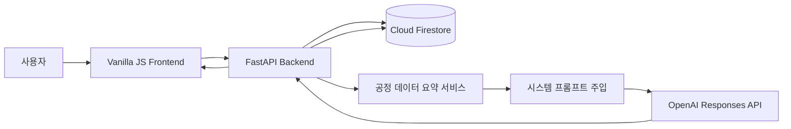
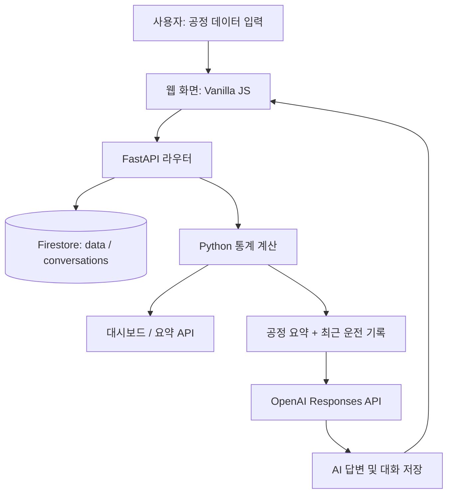

# DistillMate

증류탑 에너지·품질 운전 데이터를 분석하고, 사용자의 공정 데이터를 바탕으로 맞춤형 답변을 제공하는 AI 공정 분석 비서입니다.

## 1. 서비스 소개

일반적인 AI 챗봇은 사용자의 실제 공정 데이터를 알지 못하기 때문에 구체적인 운전 상태를 설명하기 어렵습니다.

DistillMate는 Firestore에 저장된 증류탑 시계열 데이터를 분석해 요약 정보를 생성하고, 이 요약을 OpenAI 시스템 프롬프트에 주입합니다.

사용자는 자연어 질문을 통해 다음 내용을 확인할 수 있습니다.

- 최근 스팀 원단위 변화
- 증류탑 에너지 효율 추세
- 제품 순도 기준 미달
- 이상 운전 발생 시점
- 정비 전후 에너지 효율 변화

> 본 프로젝트의 데이터는 포트폴리오 및 교육 목적으로 생성한 합성 데이터입니다. 실제 설비 운전값 변경에는 현장 엔지니어의 검토가 필요합니다.

## 2. 주요 기능

### 데이터 기반 AI 채팅

- 저장된 공정 데이터 요약을 시스템 프롬프트에 주입
- 증류탑 에너지 효율과 품질에 대한 맞춤형 답변
- AI 응답 대기 중 로딩 표시
- 기존 대화의 문맥을 활용한 후속 질문

### 운전 데이터 관리

- 운전 데이터 추가·조회·수정·삭제
- 스팀 원단위 자동 계산

### 공정 데이터 분석

- 데이터 기간 및 개수
- 평균·최대·최소 스팀 원단위
- 평균 제품 순도와 기준 미달 횟수
- 최근 7일과 이전 7일 비교
- 이상 운전 날짜
- 정비 전후 스팀 원단위 변화

### 대화 기록

- AI 채팅 자동 저장
- 대화 목록 조회 및 특정 대화 불러오기
- 대화 삭제

### 추가 기능

- 스팀 원단위 추세 그래프
- CSV 데이터 내보내기
- 다크 모드
- 반응형 화면

## 3. 데이터 설명

총 180일의 증류탑 운전 시계열 데이터를 사용합니다.

- 기간: 2026-01-01 ~ 2026-06-29
- 데이터 개수: 180개
- 핵심 지표: 스팀 원단위
- 계산식: `스팀 원단위 = 스팀 유량 / 유출액 유량`

현재 데이터 분석 결과:

- 평균 스팀 원단위: 1.282 kg-steam/kg-product
- 평균 제품 순도: 96.12%
- 제품 순도 기준 미달: 18회
- 최근 원단위 변화율: +7.42%
- 최근 에너지 효율 상태: 악화
- 정비 전후 원단위 변화율: -14.98%

## 4. 기술 스택

### Backend

- Python 3.12
- FastAPI, Uvicorn, Pydantic
- Firebase Admin SDK, Cloud Firestore
- OpenAI Responses API

### Frontend

- HTML, CSS, Vanilla JavaScript
- Canvas API

### Deployment

- Backend: Render
- Frontend: Vercel
- Database: Firebase Firestore

## 5. 시스템 구조



## 6. AI 컨텍스트 주입 흐름

1. 사용자가 공정 관련 질문을 입력합니다.
2. FastAPI가 Firestore의 운전 데이터를 조회합니다.
3. 평균, 최대, 최소, 최근 추세와 이상 운전을 계산합니다.
4. 계산된 데이터 요약을 시스템 프롬프트에 삽입합니다.
5. 사용자 질문과 기존 대화 내용을 OpenAI API에 전달합니다.
6. AI 답변을 사용자에게 반환합니다.
7. 질문과 답변을 Firestore의 `conversations` 컬렉션에 저장합니다.

이 방식을 통해 AI가 일반적인 답변이 아니라 실제 저장 데이터에 근거한 답변을 생성합니다.

## 7. Firestore 구조

### data 컬렉션

```text
data/{document_id}
├─ date
├─ value
├─ memo
├─ feed_flow_kg_h
├─ steam_flow_kg_h
├─ distillate_flow_kg_h
├─ reflux_ratio
├─ product_purity_pct
├─ top_temperature_c
├─ bottom_temperature_c
└─ operating_status
```

### conversations 컬렉션

```text
conversations/{conversation_id}
├─ title
├─ messages
│  ├─ role
│  ├─ content
│  └─ timestamp
├─ created_at
└─ updated_at
```

## 8. API 목록

| Method | Endpoint | 설명 |
|---|---|---|
| GET | `/health` | 서버 상태 확인 |
| POST | `/api/data` | 데이터 추가 |
| GET | `/api/data` | 데이터 목록 조회 |
| PUT | `/api/data/{id}` | 데이터 수정 |
| DELETE | `/api/data/{id}` | 데이터 삭제 |
| GET | `/api/data/summary` | 공정 데이터 요약 |
| POST | `/api/chat` | 데이터 기반 AI 채팅 |
| POST | `/api/conversations` | 대화 저장 |
| GET | `/api/conversations` | 대화 목록 조회 |
| GET | `/api/conversations/{id}` | 특정 대화 불러오기 |
| DELETE | `/api/conversations/{id}` | 대화 삭제 |

## 9. 배포 URL

- 프론트엔드: https://backend-seven-ivory-84.vercel.app
- 백엔드 API: https://distillmate-api.onrender.com
- Swagger UI: https://distillmate-api.onrender.com/docs

## 10. 로컬 실행 방법

### 저장소 내려받기

```powershell
git clone https://github.com/zzangminju/distillmate.git
cd distillmate
```

### 가상환경 생성 및 실행

```powershell
python -m venv .venv
.\.venv\Scripts\Activate.ps1
```

### 패키지 설치

```powershell
python -m pip install -r .\backend\requirements.txt
```

### 환경변수 설정

프로젝트 최상위의 `.env.example`을 복사해 `.env`를 생성합니다.

```powershell
Copy-Item .env.example .env
```

로컬 Firebase 서비스 계정 키 파일을 프로젝트 최상위에 `firebase-service-account.json`이라는 이름으로 저장합니다.

### 백엔드 실행

```powershell
python -m uvicorn backend.app.main:app --reload --port 8000
```

- API: http://127.0.0.1:8000
- Swagger: http://127.0.0.1:8000/docs

### 프론트엔드 실행

새 터미널에서 실행합니다.

```powershell
python -m http.server 5500 --directory frontend
```

- Frontend: http://127.0.0.1:5500

## 11. 환경변수

| 변수 | 사용 환경 | 설명 |
|---|---|---|
| `OPENAI_API_KEY` | Backend | OpenAI API 키 |
| `OPENAI_MODEL` | Backend | 사용할 OpenAI 모델 |
| `FIREBASE_SERVICE_ACCOUNT_PATH` | Local | Firebase 키 파일 경로 |
| `FIREBASE_SERVICE_ACCOUNT_JSON` | Render | Firebase 서비스 계정 JSON 문자열 |
| `ALLOWED_ORIGINS` | Backend | CORS 허용 프론트 주소 |
| `API_BASE_URL` | Vercel | Render 백엔드 API 주소 |

API 키와 Firebase 서비스 계정 키는 GitHub에 업로드하지 않습니다.

## 12. 배포 시 주의사항

Render 무료 인스턴스는 일정 시간 사용하지 않으면 중지될 수 있어 첫 요청이 지연될 수 있습니다.

프론트 화면에 API 연결 상태를 표시하고 있으며, 서버가 준비되는 동안 잠시 기다린 후 다시 시도할 수 있습니다.

배포 후 Render의 `ALLOWED_ORIGINS`에 실제 Vercel 주소를 등록해야 합니다.

## 13. 라우터와 서비스의 책임 분리

FastAPI 라우터는 HTTP 요청·응답과 상태 코드에 집중하고, 서비스는 공정 계산·Firestore 접근·AI 호출을 담당합니다. 이 기준으로 분리하면 특정 계산이나 저장 방식을 변경해도 API 주소와 요청 형식에 미치는 영향을 줄일 수 있습니다.

| 구성 요소 | 책임 | 분리한 이유 |
|---|---|---|
| `routers/data.py` | 데이터 CRUD와 요약 API의 요청·응답 처리 | HTTP 처리와 공정 계산 로직 분리 |
| `routers/conversations.py` | 대화 저장·조회·삭제 및 404 처리 | 대화 관련 API 계약을 한곳에서 관리 |
| `routers/chat.py` | AI 채팅 요청과 OpenAI 오류의 HTTP 변환 | 외부 API 오류를 일관된 사용자 메시지로 변환 |
| `services/data_service.py` | Firestore `data` 컬렉션 CRUD | DB 접근 코드를 라우터와 분리해 재사용 |
| `services/summary_service.py` | 통계, 추세, 이상 운전, 정비 효과 계산 | 대시보드와 AI 프롬프트에서 같은 결과 사용 |
| `services/conversation_service.py` | 대화 생성·정렬·메시지 추가·삭제 | 대화 저장 형식과 시간 갱신 규칙 통합 |
| `services/chat_service.py` | 컨텍스트 생성, OpenAI 호출, 대화 자동 저장 | AI 처리 순서를 HTTP 코드와 분리 |

## 14. Firestore 컬렉션 설계 이유

### `data` 컬렉션

한 날짜의 운전 조건을 하나의 문서로 저장했습니다.

- 문서 ID를 이용해 특정 기록을 바로 수정·삭제할 수 있습니다.
- `date`를 독립 필드로 두어 시간순 정렬과 향후 기간 쿼리에 사용할 수 있습니다.
- 유량·온도·순도·상태를 한 문서에 두어 AI 요약에 필요한 값을 한 번에 읽습니다.
- 계산된 스팀 원단위 `value`와 원본 유량을 함께 저장합니다. 화면과 통계에서는 `value`를 바로 사용하고, 원본 유량으로 계산값을 재검증할 수 있습니다.
- 현재는 단일 증류탑의 일별 시계열이므로 불필요한 하위 컬렉션으로 과도하게 정규화하지 않았습니다.

### `conversations` 컬렉션

하나의 대화와 메시지 배열을 하나의 문서로 저장했습니다.

- 대화를 선택할 때 한 번의 문서 조회로 전체 메시지를 불러올 수 있습니다.
- `updated_at`을 기준으로 최근 대화를 먼저 정렬할 수 있습니다.
- `role`, `content`, `timestamp`를 저장해 사용자와 AI의 대화 순서를 그대로 재현합니다.
- 교육용 서비스의 짧은 대화에서는 메시지 배열 방식이 구현과 조회에 단순합니다.

메시지가 매우 많아지면 Firestore 문서 크기와 동시 수정 충돌을 고려해 `conversations/{id}/messages/{message_id}` 하위 컬렉션으로 분리할 수 있습니다.

## 15. Pydantic 스키마와 검증 목적

Pydantic은 잘못된 값이 서비스와 Firestore에 전달되기 전에 요청을 거부하고, API의 요청·응답 형태를 Swagger에 명확히 표시하기 위해 사용합니다.

| 스키마 | 역할 | 주요 검증 |
|---|---|---|
| `DataCreate` | 신규 운전 데이터 요청 | 유량·환류비·원단위는 0보다 큰 값 |
| `DataUpdate` | 운전 데이터 수정 요청 | 생성 요청과 동일한 공정 범위 검증 |
| `DataResponse` | 운전 데이터 응답 | 검증된 필드와 Firestore 문서 ID 반환 |
| `ChatRequest` | AI 질문 요청 | 질문 1~1000자, 선택적 `conversation_id` |
| `ChatResponse` | AI 답변 응답 | `answer`, `conversation_id` 형태 고정 |
| `Message` | 대화 메시지 | 역할은 `user` 또는 `assistant`, 내용 1~5000자 |
| `ConversationCreate` | 대화 저장 요청 | 제목 1~100자와 메시지 목록 검증 |

`DataBase`의 교차 필드 검증은 아래 계산을 다시 수행합니다.

```text
value ≒ steam_flow_kg_h / distillate_flow_kg_h
```

두 값의 차이가 `0.02`를 넘으면 저장을 거부합니다. 또한 제품 순도는 `0~100%`, 메모는 `1~500자`, 운전 상태는 정의된 Enum 값만 허용합니다.

## 16. 요약 API 분리 이유와 분석 기준

`GET /api/data/summary`는 CRUD와 다른 책임을 가진 분석 전용 엔드포인트입니다.

- 프론트 대시보드가 AI 호출 없이 요약만 독립적으로 조회할 수 있습니다.
- `chat_service.py`가 동일한 `get_data_summary()`를 시스템 프롬프트 생성에 재사용합니다.
- 요약 계산을 수정해도 데이터 저장 API의 계약은 바뀌지 않습니다.
- 향후 요약 결과를 캐시하거나 배치 계산으로 전환하기 쉽습니다.

요약 기준은 `backend/app/services/summary_service.py`에서 변경합니다.

| 기준 | 현재 구현 | 변경 위치 |
|---|---|---|
| 제품 순도 기준 | `PRODUCT_PURITY_SPEC = 95.0` | 상수 수정 |
| 최근 비교 기간 | `records[-7:]` | 최근 N일에 맞게 수정 |
| 이전 비교 기간 | `records[-14:-7]` | 최근 기간과 같은 크기로 수정 |
| 추세 판정 | +3% 이상 악화, -3% 이하 개선 | `trend_change` 조건문 |
| 이상 운전 | 평균 + 표준편차 2배 초과 또는 `ABNORMAL` | `anomaly_threshold` 조건 |
| 정비 효과 | 첫 정비 시점 전후 각 14개 기록 | 전후 슬라이스 범위 |

최근 30일과 이전 30일을 비교하려면 다음처럼 변경할 수 있습니다.

```python
recent_records = records[-30:]
previous_records = records[-60:-30]
```

현재는 180개 문서를 모두 읽어 Python에서 요약합니다. 데이터가 수만 건으로 증가하면 날짜 범위 쿼리, 페이지네이션, 최근 구간 조회, 일·주·월 집계 문서, 배치 작업 기반 요약 캐시가 필요합니다.

### 요약 API 응답 예시

```json
{
  "period": "2026-01-01 ~ 2026-06-29",
  "count": 180,
  "metrics": {
    "average_steam_intensity": 1.282,
    "max_steam_intensity": 1.677,
    "min_steam_intensity": 1.152,
    "average_product_purity": 96.12,
    "off_spec_count": 18
  },
  "trend": {
    "recent_7days_average": 1.351,
    "previous_7days_average": 1.258,
    "change_percent": 7.42,
    "status": "에너지 효율 악화"
  },
  "anomaly_count": 25,
  "maintenance_effect": {
    "before_average": 1.392,
    "after_average": 1.183,
    "change_percent": -14.98
  }
}
```

## 17. 컨텍스트 주입의 장점과 한계

서버가 먼저 결정적인 통계를 계산한 뒤 요약 결과와 최근 운전 기록을 시스템 프롬프트에 삽입합니다. AI에게 모든 산술 계산을 맡기지 않기 때문에 동일 데이터에 대한 수치의 일관성을 높일 수 있습니다.

### 장점

- 실제 저장된 공정 수치에 근거한 맞춤형 답변을 제공합니다.
- 서버가 계산한 통계를 사용해 AI의 산술 오류 가능성을 줄입니다.
- 단위와 답변 규칙을 프롬프트에 포함해 출력 형식을 통제합니다.
- 데이터가 변경되면 다음 질문부터 최신 요약을 반영합니다.

### 단점과 리스크

- 질문마다 데이터 조회와 계산이 발생해 응답 시간과 비용이 증가할 수 있습니다.
- 잘못된 센서값이나 메모가 저장되면 AI 답변의 근거도 잘못될 수 있습니다.
- 프롬프트가 길어지면 토큰 비용이 증가합니다.
- AI 답변은 확률적이므로 같은 질문의 표현이 달라질 수 있습니다.
- 관찰된 상관관계를 실제 공정 원인으로 단정할 위험이 있습니다.

프롬프트에는 데이터에 없는 원인을 단정하지 않고, 관찰과 확정 원인을 구분하며, 실제 운전값 변경에는 현장 엔지니어 검토가 필요하다는 규칙을 포함했습니다. 출력 토큰도 500으로 제한했습니다.

## 18. 프론트엔드 상태관리 흐름

프레임워크 없이 `frontend/app.js`의 단일 상태 객체를 사용합니다.

```javascript
const state = {
  records: [],
  summary: null,
  conversations: [],
  currentConversationId: null,
};
```

| 상태 | 갱신 시점 | 사용하는 기능 |
|---|---|---|
| `records` | 시작 시, CRUD 완료 후 `loadData()` | 데이터 표, 수정 폼, 그래프, CSV |
| `summary` | 시작 시, CRUD 완료 후 `loadSummary()` | 요약 카드, 인사이트, 평균 기준선 |
| `conversations` | 시작 시, 채팅 저장·삭제·새로고침 후 | 대화 목록 |
| `currentConversationId` | 새 대화, 대화 불러오기, 채팅 응답 후 | 후속 질문 연결과 선택 상태 |

앱 시작 시 `Promise.allSettled()`로 데이터, 요약, 대화 목록을 함께 불러옵니다. CRUD 완료 후에는 `loadData()`와 `loadSummary()`를 동시에 실행해 목록과 통계가 서로 다른 상태가 되지 않도록 합니다. 화면 크기가 바뀌면 150ms 디바운스 후 Canvas 그래프를 다시 그립니다.

## 19. 대화 저장 시점과 실패 처리

대화 저장은 OpenAI 답변이 성공적으로 생성된 직후 동기적으로 수행합니다.

- 새 대화는 질문과 답변으로 새 Firestore 문서를 생성합니다.
- 기존 대화는 메시지를 추가하고 `updated_at`을 갱신합니다.
- 저장 성공 후에만 `conversation_id`를 포함한 최종 응답을 반환합니다.
- 존재하지 않는 대화는 `404`, OpenAI 연결 실패는 `502`, 시간 초과는 `504`로 처리합니다.
- 프론트는 실패 메시지를 채팅과 토스트에 표시하고 로딩 상태를 해제합니다.

현재 OpenAI 호출과 Firestore 저장을 하나의 분산 트랜잭션으로 묶거나 자동 롤백하지 않습니다. OpenAI 답변 후 저장이 실패하면 사용자가 다시 시도해야 합니다. 운영 규모가 커지면 요청 ID 또는 멱등성 키로 중복 저장을 방지할 수 있습니다.

## 20. 입력 검증과 출력 보안 정책

### 허용 입력

- 날짜: ISO 날짜 형식
- 유량·환류비·원단위: 0보다 큰 숫자
- 제품 순도: 0~100 범위
- 운전 상태: `NORMAL`, `PARTIAL_LOAD`, `MAINTENANCE`, `ABNORMAL`
- 메모: 1~500자
- AI 질문: 1~1000자
- 대화 제목: 1~100자
- 메시지: 1~5000자

### 차단 및 안전 처리

- 잘못된 자료형·범위·Enum 값은 Pydantic이 `422`로 거부합니다.
- 원단위 계산이 허용 오차를 벗어나면 저장하지 않습니다.
- 채팅 메시지는 `textContent`로 출력합니다.
- HTML 템플릿에 들어가는 대화 제목과 ID는 `escapeHtml()`로 이스케이프합니다.
- 사용자 입력 HTML이나 JavaScript를 코드로 실행하지 않습니다.
- 키와 서비스 계정 정보는 서버 환경 변수로만 관리합니다.

현재 욕설이나 주제 키워드를 차단하는 내용 기반 필터는 적용하지 않았습니다. 대신 길이, 자료형, 숫자 범위, Enum, 교차 필드 계산을 검증하고 출력 시 HTML을 이스케이프합니다.

## 21. 배포 환경 변수와 운영 예시

### Render

```text
OPENAI_API_KEY=<OpenAI API 키 한 개만 입력>
OPENAI_MODEL=gpt-4.1-mini
FIREBASE_SERVICE_ACCOUNT_JSON=<서비스 계정 JSON 전체>
ALLOWED_ORIGINS=http://localhost:5500,http://127.0.0.1:5500,https://backend-seven-ivory-84.vercel.app
PYTHON_VERSION=3.12.7
```

각 변수는 Render의 별도 입력란에 저장합니다. `OPENAI_API_KEY` 값에 다른 환경 변수를 줄바꿈으로 함께 넣으면 인증 헤더가 깨지므로 반드시 분리합니다.

### Vercel

```text
API_BASE_URL=https://distillmate-api.onrender.com
```

브라우저는 Vercel과 Render를 서로 다른 출처로 판단하므로 `ALLOWED_ORIGINS`에 실제 프론트 주소를 등록해야 합니다. 임의의 전체 허용값 `*` 대신 로컬 개발 주소와 실제 배포 도메인만 허용합니다.

Render 무료 서버가 잠들어 있을 때 사용자에게 권장하는 안내는 다음과 같습니다.

> 무료 서버가 준비되는 중입니다. 첫 접속은 최대 1분 정도 걸릴 수 있습니다. 잠시 기다린 후 새로고침해 주세요.

API 키와 서비스 계정 키가 코드, README, 로그에 노출되면 즉시 기존 키를 폐기하고 새 키로 교체합니다.

## 22. 검증 시나리오

### 배포 API

```powershell
Invoke-RestMethod -Uri "https://distillmate-api.onrender.com/health"
Invoke-RestMethod -Uri "https://distillmate-api.onrender.com/api/data/summary"
```

Swagger의 `Try it out`에서 요청 스키마, 상태 코드, 실제 JSON 응답을 확인할 수 있습니다.

### 데이터 CRUD

1. 새 운전 데이터를 입력합니다.
2. 저장 성공 안내와 목록 갱신을 확인합니다.
3. 수정 버튼으로 기존 값이 입력 폼에 표시되는지 확인합니다.
4. 수정·삭제 후 목록과 요약 카드가 함께 갱신되는지 확인합니다.

### AI 채팅과 대화 저장

1. “최근 증류탑 에너지 효율은 어때?”라고 질문합니다.
2. 로딩 표시와 입력 비활성화를 확인합니다.
3. 최근 7일 평균, 이전 7일 평균, 변화율이 포함된 답변을 확인합니다.
4. 대화 목록에 새 대화가 생성되는지 확인합니다.
5. 대화를 선택했을 때 전체 질문과 답변이 다시 표시되는지 확인합니다.

### 모바일·반응형

1. 브라우저 개발자 도구에서 모바일 화면 크기로 변경합니다.
2. 요약 카드, 입력 폼, 대화 목록이 화면 폭에 맞게 배치되는지 확인합니다.
3. 화면 크기 변경 후 그래프가 다시 그려지는지 확인합니다.
4. 터치 환경에서 저장·수정·삭제·채팅 버튼을 사용할 수 있는지 확인합니다.

## 23. 현재 한계와 개선 방향

- 대규모 데이터에서는 날짜 쿼리와 요약 캐시가 필요합니다.
- 장기 대화는 메시지 하위 컬렉션으로 분리할 필요가 있습니다.
- OpenAI와 Firestore 사이의 분산 트랜잭션과 자동 롤백은 구현하지 않았습니다.
- 사용자 인증이 없어 현재는 단일 사용자 포트폴리오 서비스입니다.
- 실제 공정 적용 전 센서 이상치, 결측치, 단위 일관성을 추가 검증해야 합니다.
- AI 답변 품질을 정량 평가하는 테스트 데이터셋과 회귀 테스트를 추가할 수 있습니다.

## 24. 제출 스크린샷

### 공정 운전 요약

180일 운전 데이터의 평균 스팀 원단위, 평균 제품 순도, 최근 에너지 추세, 이상 운전 및 정비 효과를 시각화합니다.


### 데이터 관리

운전 데이터 입력 폼과 최근 운전 기록을 제공하며, 데이터 추가·조회·수정·삭제 기능을 지원합니다.


### AI 채팅 및 대화 기록 불러오기

저장된 공정 데이터 요약을 기반으로 AI가 답변하며, 이전 대화 목록을 조회하고 다시 불러올 수 있습니다.


25. 평가 문항 답변 및 구현 근거
핵심: DistillMate는 증류탑의 운전 데이터를 분석해 에너지 효율·제품 품질·이상 운전을 시각화하고, 계산된 통계를 근거로 AI가 질문에 답하는 웹 애플리케이션입니다.

검증 범위: 이 문서는 실제 GitHub 코드와 기존 README를 대조해 작성했습니다. 코드 구현 확인 ≠ 현재 배포 서버에서 실제 작동 확인입니다. 전달받은 평가표에서는 1~4번 항목이 PASS로 체크되어 있지만 여기서는 독립 실행 테스트를 했다고 주장하지 않습니다.

빠른 안내
항목	확인하는 내용	이 README에서 제공하는 근거
1. 실행·연동	배포·Swagger·데이터 저장·AI·대화·모바일 (6문항)	소스 흐름 + 배포 환경 재검증 방법
2. 설계·구조	라우터/서비스·DB 설계·Pydantic·화면 상태 (4문항)	설계 선택 이유 + 관련 코드
3. AI·데이터	프롬프트 주입·요약 API·대화 저장·환경변수 (4문항)	채택 이유 + 장단점 + 구현 위치
4. 문제 대응	콜드스타트·CORS·입력 보안·확장성 (4문항)	문제 원인 + 현재 대응 + 개선 방향


바로가기: 서비스 소개 · 1. 실행·연동 · 2. 설계·구조 · 3. AI·데이터 · 4. 문제 대응 · 검증 체크리스트

<a id="distillmate-서비스-소개"></a>
앱 소개 — DistillMate
한 문장으로: 증류탑 운전 데이터를 대시보드로 분석하고, 계산 결과를 AI에게 제공해 자연어로 설명하는 화학공학 AI 공정 분석 비서입니다.
서비스 구성	설명
입력	스팀·유출액·원료 유량, 환류비, 제품 순도, 탑정/탑저 온도, 운전 상태·메모
자동 계산	스팀 원단위 = 스팀 유량 ÷ 유출액 유량 (kg-steam/kg-product)
공정 분석	최근 7개 기록과 이전 7개 비교, 순도 기준 미달, 이상 운전, 정비 전후 지표
AI 비서	Python이 계산한 데이터 요약과 최근 기록에 근거해 답변, 기존 대화 이어가기
데이터 관리	Firestore 저장, 추가/조회/수정/삭제, CSV 내보내기, 대화 목록/복원



사용한 데이터는 실제 플랜트 측정치가 아닌 180일 분량의 교육용 합성 데이터입니다. 공정 자동제어·안전진단·운전조건 변경 지시를 제공하지 않습니다.

링크: 웹사이트 · Swagger API · 소스코드
<a id="rubric-runtime"></a>
1. 실행 및 실제 연동 <sub>(6문항)</sub>
웹/서버 및 DB가 실제로 동작하는지 확인하는 항목입니다. 아래의 설계 확인과 실제 배포 테스트를 구분했습니다.
Q1-1. 배포된 웹 서비스 URL로 정상 접속이 가능한가?
핵심 답변: Vercel 프론트엔드와 Render 백엔드로 분리 배포하도록 구성했습니다.

프론트엔드는 Vercel, 백엔드는 Render에 분리 배포하도록 구성했습니다. 프론트 URL은 https://backend-seven-ivory-84.vercel.app이고, Render API는 https://distillmate-api.onrender.com입니다. [`vercel.json`](vercel.json)은 정적 프론트엔드를 빌드하도록 설정하며, [`frontend/build-config.js`](frontend/build-config.js)는 배포 시 API_BASE_URL을 프론트 런타임 설정 파일에 기록합니다. 따라서 브라우저의 웹 화면이 Render API에 요청을 보낼 수 있도록 설계했습니다.

📁 코드 근거
[`vercel.json`](vercel.json), [`frontend/build-config.js`](frontend/build-config.js), [`render.yaml`](render.yaml), [`README.md`](README.md) 9·21절.

🔍 실행 확인 방법
실제 브라우저에서 Vercel URL을 열어 첫 화면이 나타나는지, 우측 API 연결 상태가 정상인지 확인해야 합니다. 소스코드만으로 현재 접속 성공은 보장할 수 없습니다.

검토 상태: 배포 설정 확인 · 현재 URL의 실제 응답 재검증 필요
Q1-2. Swagger UI에서 API 문서를 확인할 수 있는가?
핵심 답변: FastAPI의 자동 생성 OpenAPI 문서를 /docs에서 확인할 수 있도록 설계했습니다.

백엔드는 FastAPI app = FastAPI(...)로 실행하며 데이터 CRUD, 요약, 채팅, 대화 기록 라우터를 등록합니다. FastAPI가 요청·응답 스키마를 OpenAPI 문서로 자동 생성하므로 /docs에서 각 API 경로, 요청 본문, 응답 형식과 테스트 입력창(Try it out)을 확인할 수 있습니다. 주요 API는 GET /health, GET /api/data, POST /api/data, PUT/DELETE /api/data/{id}, GET /api/data/summary, POST /api/chat, GET/POST /api/conversations 등입니다.

📁 코드 근거
[`backend/app/main.py`](backend/app/main.py), [`backend/app/routers/data.py`](backend/app/routers/data.py), [`backend/app/routers/chat.py`](backend/app/routers/chat.py), [`backend/app/routers/conversations.py`](backend/app/routers/conversations.py).

🔍 실행 확인 방법
https://distillmate-api.onrender.com/docs에서 OpenAPI UI와 각 엔드포인트가 실제 표시되는지 확인해야 합니다.

검토 상태: API 정의 확인 · 배포 Swagger 화면 재검증 필요
Q1-3. 웹에서 데이터를 추가하면 Firestore에 저장되고 목록에 반영되는가?
핵심 답변: 입력 → Pydantic 검증 → Firestore 저장 → 목록·요약 재조회 흐름을 구현했습니다.

사용자가 운전 데이터 폼을 제출하면 [`frontend/app.js`](frontend/app.js)의 saveData()가 입력을 JSON으로 변환해 POST /api/data를 호출합니다. 이 요청은 routers/data.py에서 DataCreate로 검증한 뒤 services/data_service.py의 create_data()로 전달됩니다. 서비스는 db.collection("data").document()로 Firestore 문서를 생성해 저장합니다. 프론트엔드는 저장 성공 후 loadData()와 loadSummary()를 호출하여 목록, 차트, 요약 카드를 다시 받아 화면에 반영합니다. 수정은 PUT, 삭제는 DELETE 요청과 같은 갱신 흐름을 따릅니다.

📁 코드 근거
[`frontend/app.js`](frontend/app.js)의 buildDataPayload(), saveData(), loadData(); [`backend/app/routers/data.py`](backend/app/routers/data.py); [`backend/app/services/data_service.py`](backend/app/services/data_service.py).

🔍 실행 확인 방법
웹에서 합성 테스트 기록 한 건을 추가해 목록에 보이는지, Firestore 문서가 생성됐는지 확인한 뒤 테스트 기록을 삭제합니다. 실제 DB 반영을 이 문서 작성 과정에서 재현한 것은 아닙니다.

검토 상태: 코드 흐름 확인 · 실제 Firestore 왕복 테스트 필요
Q1-4. /api/data/summary가 정상 응답하고 채팅 답변이 요약 정보를 반영하는가?
핵심 답변: 대시보드와 AI 채팅이 동일한 통계 계산 함수를 재사용합니다.

GET /api/data/summary는 summary_service.get_data_summary()를 호출하여 날짜 범위, 데이터 개수, 스팀 원단위 평균·최대·최소, 제품 순도 평균·미달 횟수, 최근 7일 추세, 이상 운전 횟수, 정비 전후 변화를 JSON으로 반환합니다. 채팅에서도 동일한 함수를 chat_service.build_system_prompt()가 호출하고 그 결과와 최근 7일 운전 기록을 AI의 instructions에 넣습니다. 그래서 화면의 요약 계산과 AI가 참고하는 계산 로직을 공유합니다.

📁 코드 근거
[`backend/app/routers/data.py`](backend/app/routers/data.py), [`backend/app/services/summary_service.py`](backend/app/services/summary_service.py), [`backend/app/services/chat_service.py`](backend/app/services/chat_service.py).

🔍 실행 확인 방법
Swagger에서 요약 응답을 보고 “최근 에너지 효율이 어때?”라고 채팅한 뒤 최근 두 구간 평균·변화율·판정이 일치하는지 비교합니다. 답변은 생성형이므로 매번 문장이 동일하지 않을 수 있으며, 최신 DB 값이 같은지 먼저 확인해야 합니다.

검토 상태: 공통 집계 함수 확인 · 실제 AI 응답 비교 필요
Q1-5. 대화가 저장되고 대화 목록 조회 및 ‘불러오기’가 동작하는가?
핵심 답변: AI 답변이 성공하면 질문·응답을 저장하고, 선택한 대화를 복원할 수 있도록 구현했습니다.

POST /api/chat이 AI 답변을 성공적으로 생성하면 chat_service.generate_chat_response()가 사용자 질문과 AI 답변을 Message 형태로 만든 뒤 Firestore의 conversations 컬렉션에 새 대화를 생성하거나 기존 대화에 메시지를 추가합니다. 대화 문서는 title, messages, created_at, updated_at을 저장합니다. 화면의 loadConversations()는 전체 목록을 최신 수정 순으로 보여주고, loadConversation(id)는 선택한 대화의 메시지를 다시 그려 줍니다. 사용자가 후속 질문을 하면 최근 대화 메시지 최대 10개를 AI 요청에 포함합니다.

📁 코드 근거
[`backend/app/services/chat_service.py`](backend/app/services/chat_service.py), [`backend/app/services/conversation_service.py`](backend/app/services/conversation_service.py), [`backend/app/routers/conversations.py`](backend/app/routers/conversations.py), [`frontend/app.js`](frontend/app.js).

🔍 실행 확인 방법
질문 1회 → 대화 목록 생성 → 목록 선택 → 기존 메시지 복원 → 후속 질문을 시험해야 합니다. AI 호출 또는 Firestore 저장이 실패하면 성공 처리하지 않도록 되어 있습니다.

검토 상태: 저장·불러오기 코드 확인 · 실제 저장 및 복원 테스트 필요
Q1-6. 모바일/작은 화면에서도 주요 기능을 사용할 수 있는가?
핵심 답변: 반응형 CSS와 Canvas 재렌더링으로 작은 화면에 대응했습니다.

CSS는 화면 폭에 따라 레이아웃을 조정합니다. 1100px 이하에서는 일부 다열 화면을 축소하고, 800px 이하에서는 대시보드 및 채팅 영역을 한 열로 배치하며, 560px 이하에서는 폼·요약 카드와 채팅 입력을 세로로 재배치합니다. 차트는 화면 크기가 변할 때 150ms 디바운스 후 Canvas를 다시 그립니다. 따라서 입력, 요약 확인, 대화 조회·전송을 작은 화면에서도 사용할 수 있도록 구성했습니다.

📁 코드 근거
[`frontend/styles.css`](frontend/styles.css)의 @media 규칙, [`frontend/app.js`](frontend/app.js)의 drawTrendChart()와 resize 이벤트.

🔍 실행 확인 방법
800px 이하에서는 .status-badge가 숨겨져 API 연결 상태를 확인하기 어려운 한계가 있습니다. 375px·768px 및 실제 모바일 기기에서 폼, 표, 차트, 채팅을 조작하는 추가 테스트가 필요합니다.

검토 상태: 반응형 CSS 확인 · 모바일 실기기 사용성 테스트 필요
<a id="rubric-design"></a>
2. 백엔드·DB·프론트 설계 <sub>(4문항)</sub>
코드가 어떻게 분리되어 있으며, 왜 그 구조를 선택했는지 설명합니다.
Q2-1. FastAPI에서 라우터/서비스 등을 어떤 기준으로 분리했는지 설명할 수 있는가?
핵심 답변: 라우터는 HTTP 처리, 서비스는 데이터·통계·AI 비즈니스 로직을 담당하도록 분리했습니다.

라우터는 HTTP 계층, 서비스는 업무 로직이라는 기준으로 분리했습니다. routers/data.py는 URL·HTTP 메서드·요청 스키마·404 등 API 응답을 담당하고, services/data_service.py는 Firestore 저장·조회·수정·삭제를 수행합니다. services/summary_service.py는 평균·이상치·정비 효과를 계산하며, routers/chat.py는 AI 요청의 성공/실패를 HTTP 상태로 변환하고 services/chat_service.py는 프롬프트 생성과 모델 호출을 수행합니다. 이렇게 하면 데이터 분석 기준을 바꾸더라도 URL이나 프론트 호출 규약을 덜 변경해도 되고, 계산·DB·AI 기능을 독립적으로 유지보수할 수 있습니다.

📁 코드 근거
backend/app/routers/, backend/app/services/, backend/app/models/, [`backend/app/main.py`](backend/app/main.py); 기존 README 13절.

검토 상태: 코드에서 책임 분리 확인
Q2-2. data / conversations 컬렉션 구조를 왜 그렇게 설계했는지 설명할 수 있는가?
핵심 답변: 운전 데이터는 날짜별 문서, 대화는 대화별 메시지 배열 문서로 설계했습니다.

data는 하루의 증류탑 운전조건을 문서 하나로 저장하도록 설계했습니다. 날짜, 스팀·유출액·원료 유량, 환류비, 순도, 온도, 운전 상태, 스팀 원단위 및 메모를 같이 저장하면 특정 날짜 레코드의 수정·삭제와 통계 집계가 간단해집니다. 계산값(value)과 계산에 사용한 원본 유량을 함께 저장하되 Pydantic에서 일치하는지 검사합니다. conversations는 대화 하나를 문서 하나로 보고 메시지 배열과 생성·수정 시각을 저장해 한 번의 읽기로 대화를 복원하도록 했습니다. 짧은 포트폴리오 대화에 구현이 간단하다는 장점이 있지만 대화가 길어지면 문서 크기 제한과 동시 수정 문제가 생길 수 있어 메시지 하위 컬렉션으로 분리할 수 있습니다.

📁 코드 근거
[`backend/app/services/data_service.py`](backend/app/services/data_service.py), [`backend/app/services/conversation_service.py`](backend/app/services/conversation_service.py), [`backend/app/models/data.py`](backend/app/models/data.py); 기존 README 7·14절.

검토 상태: Firestore 데이터 모델·서비스 코드 확인
Q2-3. 요청/응답 스키마(Pydantic)를 어떤 기준으로 정의했고 검증을 어디에 적용했는지 설명할 수 있는가?
핵심 답변: 입력값의 범위·형식뿐 아니라 공정 계산의 일관성도 Pydantic으로 검증합니다.

외부에서 들어오는 값이 잘못된 상태로 DB와 계산 로직에 전달되지 않도록 입력 단위·숫자 범위·문자열 길이·열거형과 계산 관계를 기준으로 스키마를 정의했습니다. DataCreate/DataUpdate는 운전 데이터 입력을 검사하고, DataResponse는 응답 데이터에 ID를 포함합니다. 유량·환류비·원단위는 0 초과, 제품 순도는 0~100%, 운전 상태는 미리 정의한 4종 Enum, 메모는 1~500자로 제한합니다.

특히 모델 검증 함수는 value ≈ steam_flow_kg_h / distillate_flow_kg_h를 재계산해 오차가 0.02를 넘으면 거부합니다. ChatRequest는 질문 길이 1~1000자를 제한하고 대화 ID를 선택적으로 받습니다. FastAPI 라우터의 요청·응답 모델 선언에서 Pydantic 검증을 적용하며 잘못된 입력은 통상 422 응답을 받습니다.

📁 코드 근거
[`backend/app/models/data.py`](backend/app/models/data.py), [`backend/app/models/chat.py`](backend/app/models/chat.py), [`backend/app/models/conversation.py`](backend/app/models/conversation.py), backend/app/routers/; 기존 README 15절.

검토 상태: Pydantic 모델·라우터 적용 확인
Q2-4. 프론트에서 ‘데이터 관리/대화 불러오기/채팅’ 화면을 어떤 상태 흐름으로 연결했는지 설명할 수 있는가?
핵심 답변: 단일 state 객체를 기준으로 데이터/요약/대화/현재 대화 ID를 동기화합니다.

프론트는 별도 프레임워크 없이 [`frontend/app.js`](frontend/app.js)의 단일 상태 객체 state = {records, summary, conversations, currentConversationId}로 화면 데이터를 관리합니다. 초기 로딩 때 Promise.allSettled()로 운전 데이터, 요약, 대화 목록을 가져옵니다. 데이터 추가·수정·삭제 후에는 loadData()와 loadSummary()를 다시 실행하여 기록 표·그래프·요약 카드의 값을 맞춥니다.

대화를 선택하면 loadConversation()이 ID로 서버에 조회 요청을 하고 저장된 메시지를 화면에 다시 표시합니다. 채팅을 보내면 currentConversationId를 함께 전송해 새 대화인지 후속 질문인지 구분하며, 답변 성공 후 대화 목록을 갱신합니다. 이벤트 핸들러에서 상태와 화면 갱신을 연결하도록 구현했습니다.

📁 코드 근거
[`frontend/app.js`](frontend/app.js)의 state, initializeApp(), saveData(), loadConversation(), sendChatMessage(); 기존 README 18절.

검토 상태: 프론트 상태·이벤트·API 호출 확인
<a id="rubric-ai"></a>
3. AI·데이터 설계 근거 <sub>(4문항)</sub>
정확한 통계 계산과 AI 설명의 역할을 분리한 이유를 다룹니다.
Q3-1. ‘컨텍스트 주입(요약→시스템 프롬프트)’을 왜 사용했고 어떤 장단점이 있는지 설명할 수 있는가?
핵심 답변: Python이 통계를 먼저 계산하고 AI는 그 결과와 최근 기록을 해석하도록 했습니다.

일반 AI 모델은 사용자의 Firestore 데이터에 자동으로 접근할 수 없습니다. 그래서 Python이 먼저 평균·추세·순도 미달·이상 운전·정비 전후 변화처럼 재현 가능한 숫자를 계산하고, build_system_prompt()가 이 값 및 최근 기록을 AI 시스템 지침에 삽입하도록 했습니다. 장점은 (1) AI가 실제 기록에 근거한 답을 제공하고, (2) 산술을 모델이 즉석에서 추정하는 것보다 통계 수치의 일관성이 높고, (3) 단위 표기·원인 단정 금지 같은 설명 규칙을 적용할 수 있다는 점입니다.

한계는 질문마다 데이터를 재조회하므로 지연·비용이 생기고, 잘못된 입력이나 메모가 AI 답변에 영향을 줄 수 있으며, AI가 관찰된 현상을 인과관계로 과장할 위험이 남는다는 점입니다. 시스템 프롬프트에 사용자 메모가 포함되므로 프롬프트 인젝션에 대한 추가 방어가 필요합니다.

📁 코드 근거
[`backend/app/services/chat_service.py`](backend/app/services/chat_service.py)의 build_system_prompt()·generate_chat_response(), [`backend/app/services/summary_service.py`](backend/app/services/summary_service.py); 기존 README 17절.

검토 상태: 통계→프롬프트 연결 및 제약 규칙 확인
Q3-2. 데이터 요약(/api/data/summary)을 별도로 둔 이유(책임 분리/재사용성 등)를 설명할 수 있는가?
핵심 답변: 요약 로직을 AI와 분리해 대시보드·챗봇에서 공통으로 재사용합니다.

집계는 AI 채팅과 다른 책임이므로 GET /api/data/summary라는 독립적인 읽기 전용 API로 구성했습니다. 프론트 대시보드는 모델 호출 없이 통계를 조회할 수 있고, 채팅은 같은 get_data_summary() 함수를 호출해 공통된 집계 결과를 프롬프트에 전달할 수 있습니다. 이 구조는 통계 코드를 한곳에서 관리하므로 계산 기준이 변경돼도 대시보드와 AI가 서로 다른 공식을 쓰는 일을 줄입니다. 또한 추후 캐시 또는 배치 집계를 도입하더라도 UI와 채팅 양쪽을 수정할 필요를 줄입니다.

📁 코드 근거
[`backend/app/routers/data.py`](backend/app/routers/data.py)의 /summary 엔드포인트, [`backend/app/services/summary_service.py`](backend/app/services/summary_service.py), [`backend/app/services/chat_service.py`](backend/app/services/chat_service.py); 기존 README 16절.

검토 상태: 요약 API와 재사용 구조 확인
Q3-3. 대화 저장 방식(언제 저장하는지, 어떤 형태로 저장하는지)을 선택한 이유를 설명할 수 있는가?
핵심 답변: AI 답변 성공 직후 질문·답변을 Firestore에 함께 저장하도록 했습니다.

사용자가 질문한 직후가 아니라 AI 답변이 정상 생성된 후 사용자 질문과 AI 응답을 한 쌍으로 저장합니다. 새 대화라면 Firestore conversations에 title, messages 배열, created_at, updated_at을 포함한 문서를 만들고, 기존 대화라면 메시지 배열을 확장한 후 updated_at을 갱신합니다. 짧은 대화 기록을 한 문서로 가져와 복원하기 간단하기 때문에 이 형태를 선택했습니다. 응답에는 conversation_id를 담아 다음 질문에서 문맥을 이어갈 수 있도록 했습니다. 단, AI는 성공했지만 Firestore 쓰기에 실패한 경우 답변을 확정 반환하지 못하고, 두 작업을 하나의 트랜잭션으로 묶지는 않았습니다. 메시지가 많아지면 하위 컬렉션으로 분리하거나 중복 요청 방지 기능을 고려해야 합니다.

📁 코드 근거
[`backend/app/services/chat_service.py`](backend/app/services/chat_service.py), [`backend/app/services/conversation_service.py`](backend/app/services/conversation_service.py), [`backend/app/models/conversation.py`](backend/app/models/conversation.py); 기존 README 14·19절.

검토 상태: 대화 저장 로직 확인
Q3-4. 환경 변수를 어떤 이유로 도입했고(보안/배포), 실제로 어떻게 적용했는지 설명할 수 있는가?
핵심 답변: 비밀키와 배포 환경별 설정을 코드와 분리하기 위해 환경 변수를 도입했습니다.

API 키나 Firebase 서비스 계정 인증정보를 소스에 직접 넣으면 GitHub 공개나 재배포 과정에서 노출될 수 있어 환경 변수로 분리했습니다. 로컬 환경에서는 .env.example을 참고해 Git에서 제외된 .env와 서비스 계정 키 파일을 설정하고, Render에서는 OPENAI_API_KEY, FIREBASE_SERVICE_ACCOUNT_JSON, OPENAI_MODEL, ALLOWED_ORIGINS를 런타임 환경 변수로 관리합니다. Firebase 연결 모듈은 JSON 문자열이나 로컬 파일 경로 중 제공된 방식으로 인증합니다.

Vercel에서는 빌드 시 API_BASE_URL을 받아 [`frontend/build-config.js`](frontend/build-config.js)가 브라우저용 runtime-config.js를 생성하도록 했습니다. 공개 프론트의 API 주소는 브라우저에 보일 수 있어도 되지만 인증 비밀키는 프론트 환경 변수에 포함시키면 안 됩니다.

📁 코드 근거
.env.example, .gitignore, [`render.yaml`](render.yaml), [`frontend/build-config.js`](frontend/build-config.js), [`backend/app/database/firestore.py`](backend/app/database/firestore.py), [`backend/app/services/chat_service.py`](backend/app/services/chat_service.py), [`backend/app/main.py`](backend/app/main.py); 기존 README 11·21절.

검토 상태: 환경변수 로딩·배포 설정 코드 확인 · 운영 환경의 실제 설정값은 별도 확인
<a id="rubric-operations"></a>
4. 장애 대응·보안·확장성 <sub>(4문항)</sub>
현재 구현과 아직 구현하지 않은 보완점을 분리했습니다.
Q4-1. 첫 접속 지연(콜드스타트)이 발생했을 때 사용자가 납득할 수 있도록 어떻게 안내/완화했는지 설명할 수 있는가?
핵심 답변: 첫 연결이 지연되면 “서버 준비 중”을 표시하지만, 자동 재시도는 아직 없습니다.

Render 무료 인스턴스가 유휴 상태에서 잠들었다 다시 시작하면 첫 API 응답이 지연될 수 있습니다. 프론트의 checkApiConnection()은 처음에 API 연결 중을 표시하고, 3초가 지나도 응답이 없다면 서버 준비 중으로 바꿔 사용자가 빈 화면을 오류로 오해하지 않도록 했습니다. API 응답이 성공하면 API 연결됨, 실패하면 API 연결 실패와 오류 토스트를 보여 줍니다. 다만 현재 자동 재시도나 재연결 버튼으로 지연 자체를 줄이는 기능은 구현되어 있지 않습니다. 또 800px 이하 화면에서는 상태 배지를 숨기기 때문에 모바일 안내는 개선이 필요합니다. 개선안은 상태 문구를 모바일에서도 노출하고, 제한된 재시도 기능을 추가하는 것입니다.

📁 코드 근거
[`frontend/app.js`](frontend/app.js)의 checkApiConnection(), [`frontend/styles.css`](frontend/styles.css)의 @media (max-width: 800px), [`render.yaml`](render.yaml); 기존 README 12절.

검토 상태: 안내 기능 구현 확인 · 자동 재시도·모바일 상태 표시 보완 권장
Q4-2. CORS가 왜 발생했고, 어떤 설정으로 해결했는지(허용 오리진/배포 도메인 관점) 설명할 수 있는가?
핵심 답변: 프론트와 API의 출처가 달라 발생하는 CORS 문제를 허용 출처 목록으로 제어합니다.

브라우저에서 열리는 프론트는 backend-seven-ivory-84.vercel.app, API 서버는 distillmate-api.onrender.com이므로 **도메인이 달라 서로 다른 출처(Origin)**입니다. 이때 브라우저는 API 응답에 적절한 CORS 헤더가 있는지 확인하고, JSON POST 같은 일부 요청에서는 사전 요청(preflight)을 보냅니다. FastAPI main.py의 CORSMiddleware에서 쉼표로 구분된 ALLOWED_ORIGINS를 읽어 허용된 프론트 주소를 등록하도록 했습니다.

로컬 개발 주소와 실제 Vercel 배포 주소를 환경별로 설정해 브라우저의 교차 출처 요청을 허용합니다. 모든 출처를 무조건 허용하는 것보다 허용 대상을 구체적으로 제한하는 방식입니다. 배포된 Render 환경 변수에 실제 Vercel URL이 들어갔는지는 운영 설정 화면에서 확인해야 합니다.

📁 코드 근거
[`backend/app/main.py`](backend/app/main.py)의 CORSMiddleware, .env.example, [`render.yaml`](render.yaml); 기존 README 21절.

검토 상태: CORS 미들웨어 확인 · 배포 환경의 허용 출처 재검증 필요
Q4-3. 사용자 입력을 그대로 저장/전달할 때의 위험(예: 악성 입력, 데이터 오염)과 최소 대응(검증/룰/필터)을 설명할 수 있는가?
핵심 답변: Pydantic 값 검증과 안전한 HTML 표시를 적용했지만 인증·데이터 격리는 추가 구현이 필요합니다.

검증 없이 값을 저장하면 음수 유량, 100% 초과 순도, 잘못된 운전 상태 등으로 공정 통계가 오염될 수 있고, 메모나 대화 제목의 HTML을 그대로 삽입하면 XSS 위험이 있습니다. 따라서 백엔드는 Pydantic에서 필드 범위·자료형·길이·상태 Enum과 원단위 계산 일치 여부를 확인하고, 프론트는 HTML 템플릿에 표시하는 문자열을 escapeHtml()로 처리하며 채팅 메시지는 textContent로 표시합니다. 인증 비밀키는 서버 환경 변수에 보관합니다.

이 대응은 최소 수준입니다. 별도 로그인·사용자별 Firestore 접근통제는 구현되어 있지 않고, AI 프롬프트에 삽입되는 사용자 memo를 신뢰할 수 없는 데이터로 충분히 격리하지 않았으므로 프롬프트 인젝션/데이터 오염 위험이 남아 있습니다. 따라서 실제 고객 또는 기업 데이터를 넣지 않는 데모로 제한하고, 운영 전에는 권한 관리·입력 신뢰 경계·AI 출력 검증을 강화해야 합니다.

📁 코드 근거
[`backend/app/models/data.py`](backend/app/models/data.py), [`backend/app/models/chat.py`](backend/app/models/chat.py), [`frontend/app.js`](frontend/app.js)의 escapeHtml()·appendChatMessage(), [`backend/app/services/chat_service.py`](backend/app/services/chat_service.py); 기존 README 20·23절.

검토 상태: 기본 검증·HTML 이스케이프 확인 · 인증·프롬프트 인젝션 방어 등 추가 필요
Q4-4. 데이터가 늘어나거나 요약 기준이 바뀌면(예: 최근 30일만 반영) 어디를 어떻게 수정할지 설명할 수 있는가?
핵심 답변: 집계 기준은 summary_service.py, 데이터 조회 전략은 data_service.py에서 바꿀 수 있습니다.

현재 get_data_summary()는 Firestore의 전체 data 기록을 가져온 뒤 Python에서 집계합니다. 데이터가 수만 건으로 증가하면 전체 읽기 비용·지연이 커지므로, 우선 data_service.py의 조회 기능을 날짜 범위 기반 Firestore 쿼리와 페이지네이션으로 바꾸고 대시보드·채팅에서 사용하는 구간을 명확히 분리해야 합니다. 예를 들어 최근 30개 운전 기록과 이전 30개 기록을 비교하려면 summary_service.py의 recent_records = records[-7:], previous_records = records[-14:-7]를 각각 [-30:], [-60:-30]으로 바꿉니다. 단, 이것은 최근 30일 달력 기간과 동일하지 않습니다.

날짜 누락이 있을 경우에는 특정 날짜 이후 데이터를 필터링해야 합니다. 변경 후 models/summary.py의 recent_7days_average 등 필드명, chat_service.py의 프롬프트 문구, [`frontend/app.js`](frontend/app.js)의 “최근 7일” 표시와 관련 테스트도 같이 바꿔야 합니다. 자주 조회하는 요약은 일별 집계 저장·캐시로 최적화할 수 있습니다.

📁 코드 근거
[`backend/app/services/data_service.py`](backend/app/services/data_service.py), [`backend/app/services/summary_service.py`](backend/app/services/summary_service.py), [`backend/app/models/summary.py`](backend/app/models/summary.py), [`backend/app/services/chat_service.py`](backend/app/services/chat_service.py), [`frontend/app.js`](frontend/app.js); 기존 README 16·23절.

검토 상태: 현재 집계 방식 확인 · 30일 기준 및 대규모 최적화는 개선안
<a id="rubric-checklist"></a>
5. 보너스와 제출 전 확인
보너스 크레딧: 제공된 평가표에서는 **‘미부여’**로 표시되어 있습니다. 추가 점수 획득으로 기재하지 않았습니다.
<details>
<summary><strong>제출 전 실동작 체크리스트 (클릭해서 펼치기)</strong></summary>

- [ ] Vercel 앱 접속과 Swagger /docs 렌더링 확인
- [ ] /health 및 /api/data/summary에서 실제 JSON 응답 확인
- [ ] 테스트용 운전 기록 1건을 추가한 뒤 Firestore·화면·요약 반영 확인, 테스트 데이터 삭제
- [ ] AI 질문의 수치가 요약 API의 값과 일치하는지 비교
- [ ] 대화 저장 → 목록 조회 → 이전 대화 선택·복원 → 후속 질문 확인
- [ ] 375px·768px·데스크톱에서 폼·표·차트·채팅 조작
- [ ] Render 서버가 준비 중일 때 연결 상태 안내 확인
- [ ] Render 허용 출처(ALLOWED_ORIGINS)와 Vercel API 주소(API_BASE_URL) 확인
</details>

운영 주의: 이 저장소는 사용자 인증과 계정별 데이터 격리가 없는 단일 사용자 포트폴리오 데모입니다. 실제 기업 공정 데이터, 개인정보, 비밀정보를 입력하지 마세요. 위 목록의 체크를 완료하기 전에는 실행 검증 완료로 주장하지 않습니다.